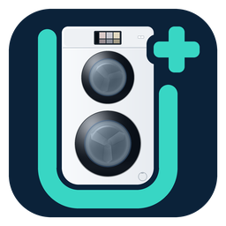

# U+ Reborn

<!-- markdownlint-disable-next-line MD033 -->


[](https://github.com/Zuz666/uplus-reborn/commits/master)
[](https://github.com/Zuz666/uplus-reborn)
[](https://www.hacs.xyz/docs/faq/custom_repositories/)
[](https://github.com/Zuz666/uplus-reborn/actions/workflows/ci.yml)

Local Home Assistant integration for the legacy **Haier HWD120-B1558U** dual-drum washer-dryer and its Haier U+ ecosystem.

U+ Reborn talks directly to the appliance over the local network. Runtime operation does not require a Haier account, Internet access, the abandoned Haier U+ app, or a cloud service. The optional cloud-assisted setup uses the legacy Euro service once to discover an already-added appliance; account credentials are never stored.

For contribution and release guidance, see [CONTRIBUTING.md](CONTRIBUTING.md),
the [release runbook](docs/release-workflow.md) and [security policy](SECURITY.md).

> [!WARNING]
> This is an independent reverse-engineering project. It is not affiliated with, endorsed by, or supported by Haier. Only the HWD120-B1558U hardware and the explicitly listed commands have been tested. Do not use it with another model.

## Current scope

Implemented for one HWD120-B1558U:

- local UWT connection on TCP port `56800`;
- account-free native UDP LAN discovery with a catalog of supported, unsupported and already-configured devices;
- DHCP discovery of the appliance IP and MAC-derived UWT device ID;
- optional cloud-assisted discovery of the appliance name, device ID, and current LAN address;
- checksum-validated status polling;
- power, physical Remote Control mode, and local-control lock;
- upper/lower reported door-lock flags (not physical door-position sensors);
- read-only upper/lower program and phase labels from the exact appliance
  profile, with hardware-observed phase corrections;
- upper/lower cycle counters and applicable remaining time;
- separate reported cycle settings for panel/U+/HA starts, without overwriting
  local next-run drafts;
- liter water and appliance-reported kWh session/cumulative counters compatible with Home Assistant long-term consumption statistics;
- opt-in, independent local drafts for all **12 upper / 20 lower programs**;
- source-defined wash time, temperature, rinses, spin speed, delay, lower
  drying, and per-program wash options;
- six ordinary stain-removal choices on the manual-supported programs, plus
  smart fabric/stain recipes with multi-stain automation actions;
- named, persistent per-drum program profiles, with local restore and explicit
  one-shot automation Start;
- Start, Pause, Resume, Cancel and completed-state Reset for both drums;
- buzzer, child lock and an explicitly enabled power switch.

See the canonical [supported-command matrix](docs/protocol.md#supported-command-matrix)
for implementation support versus the narrower physical capture evidence.

Not implemented:

- automatic pairing;
- runtime cloud status/control fallback;
- controls for other appliance models;
- bypassing the appliance's physical Remote Control requirement;
- saved program profiles or actions to save, restore or start a named profile.

Control encoding follows the inspected exact-model application source. Most
wash/dry programs and combinations have offline rather than physical acceptance
evidence. Unknown wire fields are not guessed into controls or status entities.

## Compatibility and evidence boundaries

The minimum supported Home Assistant Core is **2026.2.3**. Real isolated
Core **2026.10.1** acceptance has exercised native UI/API, entity migration,
options, lifecycle and the actual TCP path against a synthetic appliance.
Software fixtures are not hardware verification or actual HACS installation.

Representative hardware observations cover upper/lower Spin, concurrent ordinary
programs, both-drum Pause/Resume/Cancel, a lower smart recipe, delayed Start,
timed lower Dry and upper completed-state Reset. Reported buzzer/child-lock
round trips do not independently establish sound or immediate panel lockout.
Most program/option combinations remain source-derived and offline-verified.

Selected RPM, numeric delay, physical door position and complete metering
coverage have separate evidence limits; a successful command must not invent
their readback. Owner-ended intermittent rotation does not prove autonomous
completion. Unknown command outcomes are never retroactively rewritten as
success or retried automatically.

See the [protocol documentation](docs/protocol.md) for the maintained contracts
and coverage boundaries. Installation/restart chronology is not a development
checklist; use the commands below for independent development.

## Potential laundry models in the legacy APK

The **Add appliance** flow in Haier U+ 2.6.0 lists these washing-machine and
washer-dryer models:

- `HW120_BD14889U1`
- `HWD100-BD1499U1`
- `HWD120-B1558U`

U+ Reborn is currently scoped to laundry appliances. Only the
`HWD120-B1558U` has been tested on real hardware; presence in the APK is
**not** a compatibility claim for the other two models.

Owners of `HW120_BD14889U1` or `HWD100-BD1499U1` can help add support. Open an
issue with the exact model, firmware/app metadata, observed behavior, and
redacted diagnostics. Protocol work may then use owner-supervised,
one-variable-at-a-time captures to prove state and command meanings. Do not
post device IDs, account tokens, APKs, decompiled sources, or unsanitized
packet captures.

The APK also contains handlers for other appliance families. Those devices
remain outside the current project scope, but may be considered in the future.

## Control model

Remote controls are absent by default. Enable them under the integration's
**Configure** menu. Physical **Remote Control** must be enabled at the washer
after power-on.

Each drum has an independent, in-memory draft. Select a program, then adjust
its available settings and option switches. Program changes restore source
defaults; **Spin defaults to 1000 RPM**, not the earlier 400 RPM preset.
Selecting **None**, reloading the integration or restarting Home Assistant
clears the draft. Editing a draft sends no appliance traffic and does not alter
the reported program sensor. A confirmed Start clears only the target drum's
consumed draft.

Alternatively, select a smart washing fabric and a stain. The source recipe determines
the program and scalar settings; manual settings/options are unavailable in
smart mode. The atomic action below supports multiple stains.

Smart washing fabric uses a magic-wand icon to distinguish recipe selection from
ordinary parameter controls.

For the model's programme and option names, see the
[HWD120-B1558U terminology reference](docs/terminology/hwd120-b1558u.md#selected-base-terminology).
The [bilingual entity-name register](docs/terminology/hwd120-b1558u-entity-naming.md) explains compact labels,
drum prefixes and the narrow spaces used for native-card grouping.
English and Russian translations are included. Choose the frontend language in
your Home Assistant user profile; programme and option keys used by automations
do not change with the displayed language.
Entity names are created in the Home Assistant server's language; changing only
the user interface language does not rename existing entities.

For ordinary stain removal, choose **Kids´Wear** or **Casual** on the upper
drum, or **Cotton**, **Mix** or **Synthetic** on the lower drum. The existing
**Stains** selector then offers **Blood**, **Grass**, **Wine**, **Juice**,
**Soil** and **Milk**, without requiring Smart washing fabric.

An ordinary stain selects a complete recipe: temperature and the wash-stage
duration, including heating, are fixed rather than independently editable.
The Stains entity exposes `next_run_temperature_c` and
`next_run_wash_stage_minutes` attributes. Rinses, speed and compatible options
remain adjustable. Selecting a stain clears **Eco. wash**, **Night wash** and **Soak wash**;
those options remain unavailable until the stain is cleared. Selecting
**None** restores the program's temperature/main-wash defaults while preserving
unrelated draft settings.

These recipes combine exact-model source calculations with paired panel
references for Wine. The complete combinations have not all been physically
tested; see the protocol document's evidence boundaries. A retained reported
stain code alone does not prove that an externally started program is using it.

A control:

1. serializes with polling and other controls and re-checks the current opt-in;
2. reads fresh state and checks action-relevant revision and preconditions;
3. preserves applicable reported/shared fields while constructing one command;
4. sends once and requires correlated response/postcondition evidence;
5. reports **outcome unknown** if confirmation is lost, never retrying the write.

The other drum may be active. Countdown changes do not invalidate an otherwise
unchanged target state. Power, physical Remote Control and applicable lock/state
constraints still apply; there is no fabricated physical-door-position sensor.
Pause/resume use the source cycle-active flag, not a claim about motor motion.
Cancel proves a return to standby, **not draining or safe physical door opening**.
Reset applies to the completed state; it is an appliance command.

Raw response type `05` is not treated as an ACK. Separate fresh-sequence reads
may establish the postcondition without repeating the control. If the first
read is too early, a later candidate report can trigger another proof read
within the original deadline. Loss of confirmation makes entities unavailable
until ordinary polling recovers; that recovery does not retrospectively confirm
the command.

Diagnostics distinguish a confirmed operation from settings that the observed
state cannot prove: spin speed, a selected delay value, and Refresh's displayed
drying duration. Refresh follows the source builder by preserving the reported
drying byte; it does not invent a wire value for the UI's sole 30-minute choice.

Phase names are generic profile labels, not program-exclusive physical actions:
timed **Dry** may initially report **Washing** before **Drying**. Its selected
drying mode is checked separately; the reported main-wash value is zero, not
the requested drying duration.

Power is disabled by default even after opting into controls. Power-off loses
physical Remote Control; the switch is not a guaranteed way to wake an offline
appliance. Do not substitute power-off for Cancel. Treat source-only programs
and option combinations as unvalidated on hardware, not as physically certified.

## Saved program profiles

Profiles save the **complete next-run draft**, not reported settings, live
counters or appliance-wide Sound/Child lock/Power. Ordinary programs and Smart
recipes retain all supported scalar values, enabled **and disabled** options,
stains, lower drying and end time delay. Saving never starts a cycle.

### Native management and selection

1. Enable remote controls in the integration options.
2. Select a program or Smart washing fabric and configure its draft on the device page.
3. Enter **Upper new profile name** or **Lower new profile name** and commit the
   text field, then press the matching **Upper save profile** or **Lower save
   profile** button. Both controls are on the native device page.
4. Use **Upper saved profile** or **Lower saved profile** on the device page
   to restore it. This atomically replaces the whole draft, including clearing
   options not present in the profile. It sends no appliance command and does
   not alter the reported cycle settings.
5. Use the native **Update program profile**, **Rename program profile** and
   **Delete program profile** actions to manage it. Update explicitly replaces
   its complete intent from the current draft. Rename changes only its label.

No YAML or custom card is needed for this workflow. Names are unique per drum
(case-insensitive, 1–100 characters); None, Unknown and Unavailable are reserved.
A duplicate name is an error, never permission to overwrite. Profile action
dropdowns show appliance/drum/name labels and retain stable IDs behind them.
Choose a matching device and drum; cross-drum or cross-appliance use is rejected.

The name fields are independent, transient inputs (up to 100 characters). They
retain your text after a successful save or an error, and clear with drafts on
reload, restart or a control opt-in transition. Entering text never renames an
existing profile. Saving leaves both drafts and selected profiles untouched;
the new record immediately becomes a restore choice. These local controls work
while appliance polling is unavailable, but still require controls opt-in.
Blank/reserved names, duplicates and missing drafts produce errors, not defaults
or overwrites. Start is always separate. **Save program profile**
(`uplus_reborn.save_profile`) remains available in Developer tools → Actions and
automations as an alternative to the device-page controls.

After any manual draft edit the profile selector shows **None (independent
draft)**. The saved copy does not change. Selecting None only detaches the
profile label; it leaves the draft intact. Deleting a selected profile likewise
leaves its already-restored draft intact but removes the saved-profile match.
Renaming keeps the identity and any exact selected match.

Profiles survive integration reload, Core restart and upgrades locally in HA
storage, independently of the transient drafts. Reload/restart still clears
both drafts and selections; nothing is restored or started implicitly.
Removing the config entry deletes its profiles. Include HA storage in backups.
An incompatible stored intent is never filled from defaults: apply/start fails;
the record remains available for rename, explicit update from a valid draft,
or deletion.

### Profile automations

The native automation/script action editor offers the same device, drum and
profile dropdowns. The optional response from Save, Update and Rename includes
`profile_id`, `name`, `drum` and `revision`. Each drum's saved-profile selector
also exposes `profiles` (name → stable ID) and the exact selected `profile_id`.
Use the ID in YAML; a rename does not break references. A deleted ID fails
clearly rather than choosing another profile.

Apply only—local restore, **no Start**:

```yaml
action: uplus_reborn.apply_profile
data:
  device_id: YOUR_HA_DEVICE_REGISTRY_ID
  drum: lower
  profile_id: YOUR_SAVED_LOWER_PROFILE_ID
```

Explicitly start a saved revision, without using or modifying UI drafts:

```yaml
action: uplus_reborn.start_profile
data:
  device_id: YOUR_HA_DEVICE_REGISTRY_ID
  drum: upper
  profile_id: YOUR_SAVED_UPPER_PROFILE_ID
```

Start resolves one immutable revision before queuing on the existing
`start_program` control path. Concurrent draft edits, profile updates or deletion
cannot change that invocation. Control opt-in is rechecked inside the lock;
physical power/Remote Control, fresh target state, locks, errors, correlation
and confirmation still apply. An uncertain write is never retried automatically.
Local profile persistence/restore does not establish new hardware evidence.

## Requirements

- Home Assistant `2026.2.3` or newer;
- HWD120-B1558U reachable from Home Assistant over the same routed LAN;
- TCP `56800` allowed from Home Assistant to the appliance.

The Core version above is a compatibility minimum, not a security recommendation.
Keep production Home Assistant on a current patched release; historical Core
verification environments are not deployment images.

Bundled brand images require
[Home Assistant 2026.3 or newer](https://contributors.home-assistant.io/blog/2026/02/24/brands-proxy-api/).
Earlier supported versions do not load those local images; this cosmetic
difference does not raise the functional minimum.

For cloud-assisted setup, the appliance **must already be added to the owner's
account through the Haier U+ app**. U+ Reborn does not pair or provision an
appliance. The legacy app/service is used only during setup to retrieve the
existing appliance name and ID; Home Assistant stores neither the account email
nor password. If the legacy Euro service is unavailable, use DHCP discovery or
the manual setup route.

For the verified HWD120-B1558U, the UWT device ID is the appliance's Wi-Fi MAC
address: **12 uppercase hexadecimal characters without separators**. DHCP
discovery derives it automatically. For manual setup, obtain the MAC from
your router's connected-device or DHCP client list; the Haier U+ app and cloud
services are not required. The appliance must already be connected to your LAN.
Treat its MAC/device ID as private configuration and do not publish it in bug
reports or packet captures.

## Installation

### HACS

Stable HACS installation requires a published GitHub Release and its download
archive; the default branch is not a stable download. Check
[GitHub Releases](https://github.com/Zuz666/uplus-reborn/releases)
and the [release notes and known limitations](CHANGELOG.md) before installation.

1. In HACS, open the top-right menu and select **Custom repositories**.
2. Add `https://github.com/Zuz666/uplus-reborn` with type **Integration**.
3. Open **U+ Reborn** and download the published stable version.
4. Restart Home Assistant.

### Development installation

For development and isolated testing, copy `custom_components/uplus_reborn`
into the Home Assistant configuration directory as
`custom_components/uplus_reborn`, then restart Home Assistant.
This bypasses HACS repository validation and packaging; it is not proof of a
HACS installation. Supported user distribution is through HACS once published.

## Configuration

### Find on local network

1. Open **Settings → Devices & services → Add integration → U+ Reborn**.
2. Choose **🔎︎ Find on local network**. Search sends a query immediately after
   listeners are ready, then every 20 seconds per enabled IPv4 source.
3. Choose a **Discovered device** from the catalog dropdown, select **View device / last activity**
   and press **Confirm**. Unsupported and already-configured devices remain
   inspectable. Dropdown selection alone does not navigate, add or TCP-probe.
4. For a new supported HWD120-B1558U, choose **Add this supported device** and
   confirm. Addition requires a fresh checksum-valid, read-only TCP state check.

The native preview pairs **Sent / Replies / Found / Msg** with slash-separated
values: submitted UDP datagrams, valid replies, distinct devices and the latest
event. Time and query rounds stay in the stopped activity journal, not the live
preview. **Device replied** means an already-discovered device replied again.
Updates do not reload the form.
The animated washer ↔ Home Assistant illustration uses thick alternating blue
signal arrows and two expanding washer echoes after the illustrative incoming
pulse. It is decorative, not delivery or acknowledgement proof.
Reduced-motion settings show a static image.
**Show found devices** is available immediately, including with no replies.
It stops this search and opens the catalog without selecting/adding a device or
starting a TCP check. There is no duration choice or automatic timeout.

The catalog has three separate radio actions: **View device / last activity**, **Continue
searching**, and **Enter manually**, followed by one **Confirm** button. Search
and manual input do not require a selected device, including in an empty catalog.
Continue searching starts a fresh interval; retained rows keep their truthful
current-search freshness. Device details use **Back to discovery** for that route.

Repeated valid replies increase the reply count, not the distinct-device count.
**Last search activity** is the final dropdown entry, not another device. Select
it with **View device / last activity → Confirm** to open the frozen journal of up to 12 recent
events, cumulative counters and all coverage warnings, then return to the catalog.
It is available even with no responding devices, is excluded from device counts
and never permits Add or a TCP probe. Nothing is stored beyond this setup dialog.

Closing the dialog or losing its preview connection stops only its search.
Another dialog keeps its own collection; no runtime discovery loop remains.
If the connection is lost, inspect the retained catalog and explicitly return
to discovery to start again. Submission to the local stack is not delivery proof.

Device rows include a model or candidate group, full Device ID, IP address and
independent configured/support/conflict/freshness statuses. Native HA dropdowns
can shorten long labels on narrow screens; the device card retains full identity.
The compact card shows model candidates, a short identification source, category,
address, last response and addition restrictions. **Technical details** opens the
complete read-only protocol/source evidence; **Back to device** keeps the selected
identity without restarting discovery or probing TCP.

The bundled offline lookup combines APK category facts with eleven model names
across seven exact Type IDs from the manufacturer's product-selection catalog
(retrieved 2026-10-20). One match is labeled as a catalog/profile match, not a model
name read from UDP; it does not prove global Type ID uniqueness. Shared types show
all possible models on one device card, never an arbitrarily selected first model.
For example, H3F-280WSAAU1, H3F-320FSAAU1 and H3F-320WSAAU1 share a Type ID.
Category-only and unknown types remain visible without guessed model names.
Local identification needs neither Internet access nor a Haier account.

Model recognition does not expand control support beyond HWD120-B1558U, the only
model with project hardware correlation. Unsupported and already-configured
devices receive no extra TCP or cloud probes and cannot be added from their
cards. Disabled/unloaded U+ Reborn entries also block duplicates; another
integration's exact identity association is informational, not a veto.

The initial setup menu also offers **☁︎ Use Haier account** and **✎︎ Connect
manually**, with descriptions. These symbols are text and can look different
across platforms.

Discovery uses UDP destination port `7083`. Replies can target the sending
socket's ephemeral port or UDP/7083. Allow the return traffic; do not filter
replies solely by port 7083. Searches use actual adapter prefixes, not a guessed
`/24`. Socket/interface failures are reported as partial coverage. No reply
does not prove absence: VLAN/Wi-Fi isolation, blocked broadcasts and intermittent
connectivity can prevent discovery. Enable the appropriate HA network adapter
or use manual connection; discovery does not reconfigure your network.

The catalog is onboarding/inspection only: browsing never updates existing
addresses, reloads entries, changes preferences or clears program drafts.
DHCP and Reconfigure retain their existing roles. No mDNS discovery, runtime
UDP address recovery, pairing or automatic cloud fallback is added.

### Cloud-assisted setup

1. Add and verify the appliance in the **Haier U+ app** first.
2. Open **Settings → Devices & services → Add integration** and choose
   **U+ Reborn**.
3. Choose **Find appliances with Haier U+** and enter the existing U+ account
   email and password.
4. Select the HWD120-B1558U returned by the account. The flow obtains its saved
   name and device ID, then finds its current IP address on the local network.
5. If automatic LAN discovery cannot resolve the IP, enter the appliance host
   on the same selection form.
6. Setup succeeds only after a direct, checksum-valid local state response.

The credentials are sent directly to `uws-euro.haieriot.net` over HTTPS for
this flow and are discarded before the config entry is created. All subsequent
status and control traffic is local.

### Automatic DHCP discovery

1. Install U+ Reborn and restart Home Assistant.
2. Home Assistant discovers supported appliances by their DHCP MAC prefix.
3. Open the discovered U+ Reborn flow and confirm that the appliance is an
   HWD120-B1558U.
4. Setup succeeds only after a live checksum-valid state response.

The flow obtains the current IP address and derives the UWT device ID from the
full DHCP MAC. It uses a non-empty DHCP hostname as the entry name when one is
available; otherwise it uses `HWD120-B1558U`. The entry can be renamed normally
in Home Assistant. A later DHCP event updates the IP of an existing entry
without changing its device or entity identities.

### Manual fallback

1. Find the appliance's current IP address and **Wi-Fi MAC address** in your
   router's connected-device or DHCP client list. Use the appliance's address,
   not the router/access point's MAC or the appliance serial number.
2. Remove colons, hyphens or dots from the MAC and uppercase any letters.
   For example, the fictional MAC `02:11:22:33:44:55` becomes `021122334455`.
   The manual form does not perform this conversion for you.
3. Open **Settings → Devices & services → Add integration**, search for
   **U+ Reborn**, and choose **Enter local connection details manually**.
4. Enter the appliance host, port `56800`, and the converted value as **Device ID**.
5. Explicitly confirm that the appliance is **HWD120-B1558U**.
6. Setup succeeds only after a live checksum-valid local state response.

This route works without the Haier U+ app, account login or available cloud
services. It connects to an appliance already on your LAN; it does not pair
the appliance or configure its Wi-Fi connection.
Without a UDP reply, TCP communication does not independently establish the
commercial model. Known incompatible type/security or conflicting identity
evidence in the current dialog cannot be overridden by manual confirmation.

### Reconfigure the connection

Use the integration entry's **Reconfigure** action if the appliance address
changes and DHCP discovery is not available. Enter the new host and port;
the flow must obtain a checksum-valid local state before saving them. This
read never starts or cancels a program. The existing appliance identity,
entity IDs, user customizations, and history are retained.

A changed address reloads a loaded entry once. Reconfigure also schedules
setup for an unloaded or failed/retrying entry after successful validation;
an explicitly disabled entry is not silently enabled. Validating an unchanged
address on a loaded entry does not reload it.

### Configure integration options

Open **Configure** on the integration entry:

- **Polling interval (seconds):** a whole number from **15 to 30**, default
  **15**. Changing only this value updates the existing coordinator without
  a reload, immediate query, or discarded draft. An already scheduled poll
  keeps its current deadline; subsequent polls use the new interval.
- **Enable remote controls:** off by default. Enables both drums' draft
  selectors, option switches and lifecycle buttons, plus shared controls.
  Power remains disabled in the entity registry until explicitly enabled.
  Program-specific source constraints determine which settings are available.

Saving options never sends an appliance command. Changing control opt-in
reloads a loaded entry and discards both drafts. Disabling revokes permission
immediately, including for commands waiting for a poll; enabling again starts
with no draft, never a previously staged selection. A reload performs
the normal read-only setup query, not an appliance control. Unloaded/failed entries
use the saved options on their next setup. Existing registry identities,
user names, hidden flags, and explicitly disabled entities are retained.

### Troubleshooting availability and unsupported actions

An unavailable appliance means the integration has no current successful
local read. Check physical power, local network access, host/port, and
**Reconfigure** if the address changed; allow normal polling to recover.
Enabling controls does not repair connectivity. A healthy read can coexist
with unavailable buttons because physical Remote Control, a target draft,
an applicable lock or the action's target-state precondition is missing.
Inspect current state before deciding what to do after an uncertain command.

The phase sensor describes the program stage, not whether it is currently
executing: pausing can leave **Spinning** unchanged. The separate per-drum
**execution state** sensor reports Running, Paused, Standby mode, Completed or Delayed
from the same snapshot, including panel/U+ changes without HA button presses.
Running means protocol cycle activity, not continuously rotating motor.
Intermittent rotation remains the phase, not a synthetic Completed state.

Completed/drying-finished phases take precedence over the activity flag.
Standby with a reservation flag is Delayed; without reservation and activity
it is Standby, not Paused. A delayed-start phase requires the reservation flag.
Unsupported phases, active standby without reservation and delayed-start without
reservation produce **Unknown**. Loss of authoritative state produces
**Unavailable**. These read-only sensors require no control opt-in.

Native [button state](https://www.home-assistant.io/integrations/button/#button-states)
is the last HA attempted-press timestamp, not the drum's execution state or proof
of a confirmed appliance transition. HA records the timestamp before the handler,
including a press that is rejected. **Unknown** means no last-press timestamp is
available. Panel/U+ actions do not create HA button presses. **Unavailable** can
also mean that an action does not apply to the current state; it does not by
itself establish lost connectivity.

Pause/Resume stay state-gated: Running normally permits Pause, Paused normally
permits Resume, and Standby/Completed permit neither. Shared power, physical
Remote Control and lock restrictions still apply. Read the execution-state
sensor, not button history, to follow the program. If the appliance changes
after the displayed state, the command can be rejected with a state-changed or
specific prerequisite message. Wait for a fresh update before trying again;
the integration does not retry or silently reinterpret the request.

For `button.press`, target the specific Pause or Resume entity, not an entire
device/area containing opposing lifecycle controls. Multiple targets can partly
succeed; there is no batch rollback. HA may skip an unavailable target before
calling the integration, so a custom error is not guaranteed for disabled actions.

Use the integration entry's **Enable debug logging** action temporarily,
observe the problem, then **Disable debug logging** to collect the log.
Use **Download diagnostics** for the separate cached, redacted snapshot.
There is no persistent debug option in this integration. See
[Diagnostics and issue reports](#diagnostics-and-issue-reports) for reporting
and privacy guidance; never attach credentials or raw private captures.

## Entities

### Common appliance entities

| Platform | Entity | Notes |
| --- | --- | --- |
| Binary sensor | Power | Diagnostic; appliance power flag |
| Binary sensor | Remote control | Diagnostic; physical Remote Control mode required for commands |
| Binary sensor | Local control lock | Diagnostic; operational interlock |
| Sensor | Power-on session water | Diagnostic; liters; `total_increasing`; owner-observed panel-power reset; incomplete accounting |
| Sensor | Cumulative water | Diagnostic; liters; `total_increasing`; reported cumulative accounting; persistence across mains loss unverified |
| Sensor | Power-on session energy | Diagnostic; appliance-reported kWh; `total_increasing`; owner-observed panel-power reset; incomplete accounting |
| Sensor | Cumulative electricity | Diagnostic; appliance-reported kWh; `total_increasing`; reported cumulative accounting; persistence across mains loss unverified |

### Upper drum entities

| Platform | Entity | Notes |
| --- | --- | --- |
| Binary sensor | Upper door lock | Raw lock flag; `on` means locked |
| Sensor | Upper program | Authoritative read-only enum; separate from the local draft |
| Sensor | Upper phase | Profile phase vocabulary with hardware corrections for observed values |
| Sensor | Upper execution state | Running, Paused, Standby, Completed or Delayed; independent of the retained phase |
| Sensor | Upper remaining time | Minutes; unknown in standby or when omitted |
| Sensor | Upper cycle count | Diagnostic total-increasing counter |

### Lower drum entities

| Platform | Entity | Notes |
| --- | --- | --- |
| Binary sensor | Lower door lock | Raw lock flag; `on` means locked |
| Sensor | Lower program | Read-only enum containing every profile-advertised lower program |
| Sensor | Lower phase | Profile phase vocabulary with hardware corrections from the observed Bedding lifecycle |
| Sensor | Lower execution state | Same phase-aware execution contract as the upper drum |
| Sensor | Lower remaining time | Minutes; unknown in standby or when omitted |
| Sensor | Lower cycle count | Diagnostic total-increasing counter |

### Reported cycle settings

These read-only entities appear under **Sensors**, without requiring control
opt-in. Each reads the appliance's latest report, including when a program
starts from its physical panel or U+. They do not change the separate
**selected** next-run controls.

| Platform | Entity, per drum unless noted | Meaning |
| --- | --- | --- |
| Sensor | Reported target temperature | Program target in °C, not measured water temperature; 0°C means unheated |
| Sensor | Reported wash-stage time | Minutes reported for the complete wash stage, including applicable heating; may decrease |
| Sensor | Reported rinse count | Appliance-reported count that can decrease during the cycle; not the originally selected total |
| Sensor | Reported spin-stage time | Reported minutes, **not RPM** or a guaranteed original duration |
| Sensor | Lower reported drying mode | Off, Auto or the source-defined timed mode; not inferred from a draft |
| Binary sensor | Reported high water, Easy Iron, intensive, eco, soak, night | Separate reported option flags |
| Binary sensor | Reported smart mode | Smart-mode flag; does not identify the chosen fabric or stain rows |
| Binary sensor | Reported delay active | Reservation flag, not its configured duration or finish timestamp |

Values remain available for applicable paused and intermittent-rotation cycles.
In ordinary Standby, Completed, or an unknown program/phase, these setting
values are **Unknown** rather than stale selections. A reported pending Start
or reservation can establish cycle context while the phase still says Standby.
Inapplicable fields and missing reports are also Unknown. Loss of current
appliance state makes the entities **Unavailable**; recovery uses a fresh
report, never the last command or recorder history.

The report does **not yet establish** actual selected RPM, numeric delay,
original main-wash duration, active ordinary-stain treatment, or exact Smart
fabric/stain selections. The stain code can persist after panel deselection;
diagnostics preserve it but it is not an active-stain sensor. These are explicit
readback limitations, not values silently filled from the next-run draft.
Changing options on the panel need not be visible before Start: panel choices
can also be local staged settings.

### Native controls

All controls below require integration opt-in. Draft entities never send a
command by themselves.

| Platform | Surface | Behavior |
| --- | --- | --- |
| Select | Program and smart fabric, per drum | Choose one path; restore its defaults |
| Select | Saved profile, per drum | Atomically restore a complete named draft; never starts a cycle |
| Select | Wash time, temperature, rinse count, speed, delay | Source-defined choices for the ordinary program |
| Select | Lower drying | Available only where offered by the source |
| Select | Stain, per drum | One ordinary stain or one Smart recipe; the atomic action supports multiple Smart stains |
| Switch | High water, Easy Iron, intensive, eco, soak, night | Local draft options, enabled only for applicable ordinary programs |
| Button | Start, Pause, Resume, Cancel, Reset, per drum | One-shot commands with authoritative outcome handling |
| Switch | Buzzer | Configuration; enable/disable the appliance's audible-signal setting |
| Switch | Child lock | Configuration; enable/disable the appliance's child-lock setting |
| Switch | Power | Shared control; disabled by default, no guaranteed remote wake |

**Buzzer**, **Child lock** and **Power** are shared by the appliance, not
separate per-drum drafts. Changing one sends a command immediately; Start is
not required. Their displayed state comes from the appliance report, not an
optimistic local toggle. Integration control opt-in and command preconditions
still apply.

- **Buzzer** controls the washer's sound setting, not Home Assistant
  notifications. Which individual sounds it suppresses (for example button,
  completion or alarm sounds) has not been physically verified; do not assume
  that disabling it silences every alert.
- **Child lock** reports an enabled appliance setting, not proof that the
  panel is currently locked. The appliance manual (§3.7.1) describes the lock
  symbol appearing one minute after program Start. That activation timing
  has not yet been physically verified through HA. This setting does not
  lock or unlock drum doors. Its report and **Local control lock** use
  different coordinates but can turn on together; turning Child lock off
  remains permitted in that state, with power and Remote Control still required.
- **Power** is a real power command and is disabled by default in the entity
  registry. Power-off loses physical Remote Control; an offline appliance
  cannot be promised a remote wake-up.

These shared commands are implemented from the exact-model source; implementation
support is not a claim of physical verification. See the
[command evidence matrix](docs/protocol.md#supported-command-matrix).

### Categories and existing history

The 44 status entities comprise **35 primary** and **nine Diagnostic** entities.
Power, Remote control, Local control lock, session and cumulative water/energy,
and both cycle counters are Diagnostic. Both reported door-lock flags, both
drums' program/phase/execution state/remaining time and the 25 reported-setting
entities remain primary. Together with 48 controls the integration registers
92 entities when controls are enabled. Operational controls remain separate from
integration configuration. Retained entities keep their existing enabled
defaults; upgrades do not enable user-disabled entities or undo visibility
preferences.

Category changes reorganize the native device page, not the appliance data.
Diagnostic entities are also excluded from automatically generated dashboards
and are not exposed to voice assistants by default. They remain enabled unless
the user disables them. Power/Remote Control/local-lock command checks are
unchanged; inspect Diagnostics when those prerequisites block a command.
Retained entity IDs/unique IDs, user names, icons, areas, enabled/hidden choices,
and sensor display preferences are preserved. Existing Recorder history remains
attached to the same entity IDs. No statistics, counter values, units, or state
classes are migrated: all four consumption sensors retain literal L/kWh,
their numerical meaning and `total_increasing` in Diagnostic.

### Control upgrade and automations

Retained selectors keep their unique IDs and existing entity IDs, including an
upper selector previously named **Upper preset**. Its new vocabulary is the
program slug (for example `spin`) or `none`; `upper_spin_400` is removed.
Old upper Start/Cancel registrations migrate to the generic actions while
preserving entity IDs and user preferences. The twelve obsolete boolean
selectors are replaced by switches. Update automations that used those
selectors; no compatibility aliases are provided. New entities respect Home
Assistant's existing disabled-new-entities preference.

For interactive staging, use `select.select_option` and the draft switches,
then the target Start button. For automation, avoid shared mutable draft state:
the `uplus_reborn.start_program` action validates and sends one complete intent
without changing either interactive draft. Supply `device_id`, `drum`, and
exactly one of `program` or `fabric`. Omitted ordinary settings use program
defaults, except the fixed temperature/time of a selected stain recipe.
Unknown, unsupported or conflicting values are rejected before dispatch.

Native Smart fabric/stain selectors use lowercase option keys, such as `f1`
and `w15`, with translated labels in the UI. Update any `select.select_option`
automations or state comparisons that previously used `F1`/`W15`; entity IDs
are unchanged. The atomic `uplus_reborn.start_program` action below still uses
uppercase source recipe IDs.

`device_id` is the Home Assistant device-registry ID, not the appliance's UWT
identifier or MAC address. It must resolve to exactly one loaded U+ Reborn
entry with controls enabled. An unknown, foreign, unloaded or ambiguous device
is rejected rather than falling back to another registered appliance.

```yaml
action: uplus_reborn.start_program
data:
  device_id: YOUR_DEVICE_ID
  drum: upper
  program: spin
  spin_rpm: 400
```

Smart recipes accept source fabric IDs and stain IDs, but no manual scalar or
option overrides:

```yaml
action: uplus_reborn.start_program
data:
  device_id: YOUR_DEVICE_ID
  drum: upper
  fabric: F1
  stains: [W1, W15]
```

Ordinary stain removal uses semantic names rather than Smart `W` identifiers:

```yaml
action: uplus_reborn.start_program
data:
  device_id: YOUR_DEVICE_ID
  drum: lower
  program: mix
  stains: [wine]
  rinses: 8
  spin_rpm: 800
```

Use zero or one of `blood`, `grass`, `wine`, `juice`, `soil`, `milk` with an
ordinary program. Do not combine an ordinary stain with manual
`temperature_c`/`wash_minutes` overrides or `eco`, `night`, `soak` functions:
an atomic request with those conflicts is rejected, not silently normalized.

Available ordinary fields are `wash_minutes`, `temperature_c`, `rinses`,
`spin_rpm`, `drying_mode`, `delay_hours`, `enabled_functions` and `stains`.
Delay is the source UI's whole-hour **end time**, not an arbitrary start-delay
duration. Use the native action editor and capability diagnostics for
applicable values. There are no general raw-write or cloud-control actions.

## Consumption accounting

All four consumption entities retain Home Assistant water/energy device classes,
literal appliance-reported L/kWh values, and `total_increasing` state classes.
They are reported accounting, not independently calibrated or complete utility
meters. The owner observed accumulation between programs and session-counter
reset on panel power-off; neither pair has proven complete appliance coverage.

The exact target profile uses unsigned 16-bit current fields and unsigned
32-bit cumulative fields, with identity transforms, not a `/10` or `/1000`
conversion. A synchronized completed upper Spin run correlated raw `2` with
U+ `2 Liter` and raw `1` with U+ `1.0 kWh`; the target app's current-counter
finish display does not scale those values. Cumulative L/kWh units are
owner-confirmed, but an exact-target cumulative presenter and exact numeric
cumulative-screen correlation were not recovered.

The current fields sit amid the upper profile group, but are not upper-only:
lower Spin changed them from `0`/`0` to `2`/`1`. Conversely, a lower-only
Bedding cycle left them at `3`/`0` while cumulative totals increased by
`+62`/`+25` at completion. The neutral **Power-on session** label does not
promise per-cycle, per-drum, or whole-appliance coverage. The two drums do not
have independently established consumption meters.

Commit timing depends on the observed program and termination path. One upper
Spin/400 run increased cumulative water by raw `+3` and electricity by raw `+1`
during intermittent rotation (`0x0e`), with one minute remaining. Another
committed water during that phase but left energy unchanged through completion
and reported unlock. Stopping the observed lower Spin committed water `+2`
but no cumulative energy. There is no universal commit-at-zero or
commit-at-`Completed` rule. The owner observed that panel power-off may discard
a pending cumulative update; counter persistence across mains loss is unknown.

**Optional dashboards:** use **Cumulative electricity** for Energy and
**Cumulative water** for Water only if these accounting limitations are
acceptable. Dashboard compatibility is not certification of calibration or
complete coverage. Do not add the session and cumulative pairs together or
configure both as independent sources for the same appliance consumption.

**Compatibility decision:** preserve existing values, L/kWh units, unique IDs,
entity IDs, statistic IDs, and `total_increasing` semantics. This audit does not
rescale values, relabel energy as Wh, synthesize resets, duplicate counters per
drum, or rewrite statistical history. Category/presentation changes are
separate from this numerical contract. See the
[protocol accounting contract](docs/protocol.md#consumption-accounting-contract)
for raw-word layouts and wire evidence boundaries.

## Diagnostics and issue reports

Download diagnostics from the integration entry before filing an issue. Host and device ID are redacted. Diagnostics include decoded state so unsupported values can be investigated without publishing APKs, credentials, or raw private captures.

Include:

- Home Assistant version;
- integration version;
- exact appliance model and firmware shown by the legacy app, if available;
- what the physical display showed;
- what action was attempted;
- redacted integration diagnostics.

Do not attach account tokens, the device ID, APK files, decompiled sources, or unsanitized packet captures.

### System Health

Open **Settings → System → Repairs → ⋮ → System information** to view
U+ Reborn's native System Health section. It reports the integration version,
configured/loaded/available entry counts, local polling mode, and anonymous
per-entry lifecycle, configured polling interval, freshness, age of the last
successful observation, and last sanitized failure category.

Disabled or unloaded entries are not reported as actively available. An entry
that has never been read successfully has no observation age. Stale or
unavailable cached data is not a new appliance observation; a historical
failure category can remain visible after recovery without making the entry
currently unavailable.

U+ Reborn's System Health callback reads cached integration state only: it
does not request a refresh or connect to the appliance or cloud. Other
integrations' sections may perform their own checks. Download the separate
integration diagnostics for a more detailed redacted troubleshooting snapshot.

## Protocol documentation

[`docs/protocol.md`](docs/protocol.md) specifies the UWT wire protocol, state words, command encodings and hardware/source evidence for this target. It separates captured bytes, hardware observations, source-derived capabilities and unresolved meanings, and includes packet/state-machine diagrams.

The implementation is deliberately embedded under `custom_components/uplus_reborn/protocol`. It models one verified UWT appliance profile rather than claiming a generic Haier API.

## Developer commands

### Prerequisites and clean-checkout setup

Run the commands below from the repository root. Use Python **3.13.2 or newer**
within the CI-tested Python 3.13 line, [uv](https://docs.astral.sh/uv/) **0.13.4 or newer**, and
Node.js **22** with npm, matching documentation CI.

The public checkout contains the source, tests, dependency lockfiles, and
tooling required for development. No maintainer workspace, agent instructions,
private skills, credentials, APK, capture, or live appliance is required for
the normal checks. Reusable development scripts belong in [`tools/`](tools/).
See [CONTRIBUTING.md](CONTRIBUTING.md) for the module map, change workflow,
verification requirements, and release policy.

### Python tests and lint

Run the Home Assistant test suite and linter in the reproducible Docker test
container (built once per lockfile/recipe fingerprint; if Docker is unavailable,
`delivery.py docker` stops immediately with exit code 2):

```sh
uv run --no-project --python 3.13 python tools/delivery.py docker --target test -- pytest -q
uv run --no-project --python 3.13 python tools/delivery.py docker --target test -- ruff check custom_components tests
```

These use the exact locked `test` dependency group from `pyproject.toml` and
`uv.lock` (`--no-group research`) inside an immutable container `/opt/venv`.
Normal tests use isolated fixtures and must never contact live hardware.

`pytest-homeassistant-custom-component` follows Home Assistant's Linux runtime
and is not supported natively on Windows. Use the repository Docker workflow or
native Linux/CI for that suite; never rely on mutable local `.venv` or WSL trees.

For a focused protocol change:

```sh
uv run --no-project --python 3.13 python tools/delivery.py docker --target test -- pytest -q tests/test_protocol.py
```

### Documentation checks

These commands work from PowerShell on Windows or a shell on Linux:

```sh
npm ci --ignore-scripts
npm run test:docs
```

The canonical command runs pinned `markdownlint-cli2` and strict Mermaid
validation on the same sorted public file set: root Markdown (including
`CHANGELOG.md`), Markdown recursively under `docs/`, and public PR/issue templates
under `.github/`. It excludes agent instructions, other hidden/private
directories, dependencies, environments and generated artifacts, and never
follows file or directory symlinks.

Both checks run even if one fails; either failure makes the command fail.
An independent Markdown rule requires closing code fences, including in nested
lists and blockquotes. Mermaid fences are extracted with a Markdown parser
before strict validation, so nested diagrams are checked too. Diagnostics name
the original source file and preserve source line numbers.

Checks are read-only: there is no implicit fix or diagram rewrite. Syntax checks
do not establish protocol correctness or visual diagram layout. Windows and
Ubuntu CI use Node.js 22 and the same command, without private configuration or
shell-specific wrappers.

For changes to documentation tooling, also run its isolated behavioral fixtures:

```sh
npm run test:docs:tooling
```

### Reproducible artifacts and isolated Core

The standard-library artifact/evidence CLI works on Windows and Linux:

```sh
uv run --no-project --python 3.13 python tools/delivery.py build --commit HEAD --output build/delivery-candidate
uv run --no-project --python 3.13 python -m unittest discover -s tools -p "test_*.py" -v
```

It packages committed LF bytes, validates complete member hashes and can reuse
successful checks for explicitly unchanged inputs. The Docker real-Core
fixture boots that artifact against a query-only loopback peer and records
both-drum authoritative state and clean shutdown. It is not hardware or browser
acceptance. See [scoped verification and fixture setup](docs/development-verification.md)
for preparation, input-fingerprint limits and finite completion criteria.

### Protocol CLI

Use the configured Python test environment above. Help and decoding are
offline; provide your own sanitized binary input for `decode`:

```sh
uv run --no-project --python 3.13 python tools/delivery.py docker --target test -- python -m custom_components.uplus_reborn.protocol --help
uv run --no-project --python 3.13 python tools/delivery.py docker --target test -- python -m custom_components.uplus_reborn.protocol decode --file sanitized-packet.bin
```

`status` contacts a real appliance and is not a development smoke test. Only
after explicit authorization, replace the documentation-only address and
private device-ID file in this read-only example:

```sh
uv run --frozen --group test --no-group research python -m custom_components.uplus_reborn.protocol status --allow-live --host 192.0.2.10 --device-id-file ./private-device-id.txt
```

Hardware-control commands require their additional physical checks and explicit
gates. A successful read does not authorize Start, Cancel, or another write.

## License

Source code, tests, tooling, and files outside `docs/` are licensed under the
[MIT License](LICENSE), copyright 2026 U+ Reborn contributors.

Material in [`docs/`](docs/) is licensed under the
[Creative Commons Attribution 4.0 International License](docs/LICENSE).
Required attribution: **U+ Reborn contributors**, a link to
`https://github.com/Zuz666/uplus-reborn`, a link to CC BY 4.0, and an
indication of changes when applicable.
