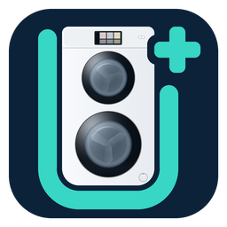

# U+ Reborn

<!-- markdownlint-disable-next-line MD033 -->


[](https://github.com/Zuz666/uplus-reborn/releases)
[](https://github.com/Zuz666/uplus-reborn/releases)
[](https://github.com/Zuz666/uplus-reborn/commits/master)
[](https://github.com/Zuz666/uplus-reborn)
[](https://www.hacs.xyz/docs/faq/custom_repositories/)
[](https://github.com/Zuz666/uplus-reborn/actions/workflows/ci.yml)

Local Home Assistant integration for the **Haier HWD120-B1558U** dual-drum
washer-dryer.

U+ Reborn communicates directly with your appliance over your local network
(TCP port `56800`) — no Haier account, cloud connection, or legacy U+ app is
required at runtime. Optional cloud lookup is supported once during initial
setup, and account credentials are never stored.

> [!WARNING]
> Independent reverse-engineering project — not affiliated with or endorsed by
> Haier. Only **Haier HWD120-B1558U** is hardware-tested and supported. Do not
> use this integration with other appliance models.

## Features

- **100% local runtime:** Direct LAN polling and control on TCP port `56800`,
  with automatic offline/online recovery when the washer switches off and back
  on.
- **Flexible setup:** Account-free local UDP discovery (`🔎︎ Find on local
  network`), automatic DHCP discovery, optional one-time Haier Euro account
  lookup (`☁︎ Use Haier account`), or manual setup (`✎︎ Connect manually`).
- **Dual-drum live monitoring:** Read-only entities for both upper and lower
  drums — live programme, phase, execution state (`Running`, `Paused`,
  `Standby mode`, `Completed`, `Delayed`), remaining time, door lock flag,
  active cycle settings, fault indicators/codes, cycle counts, and water/energy
  counters.
- **Opt-in remote control:** Disabled by default; supports independent next-run
  drafts for all **12 upper** and **20 lower** programmes, wash parameters,
  cycle options, ordinary stain recipes, **Smart washing** fabric/stain
  recipes, **Start / Pause / Resume / Cancel / Standby**, plus shared **Sound**,
  **Child lock**, and optional **Appliance power**.
- **Saved programme profiles:** Save, restore, manage, and automate named
  per-drum presets directly from the Home Assistant device page or actions.
- **English and Russian localization:** Built-in UI translations for both
  languages; automation keys stay identical across locales.

### Not supported

- Initial Wi-Fi pairing/provisioning (connect the washer to your LAN first).
- Runtime cloud status or control fallback.
- Other Haier appliance models (only `HWD120-B1558U` is supported).
- Bypassing the washer's physical **Remote Control** setting.

> [!NOTE]
> Programme definitions cover the entire exact-model HWD120-B1558U profile with
> full offline test coverage, while physical hardware testing covers
> representative programmes, options, and controls rather than every possible
> combination. See the
> [protocol command matrix](docs/protocol/hwd120-b1558u.md#supported-command-matrix)
> for exact hardware vs. source coverage.

## Requirements and installation

### Prerequisites

- **Home Assistant Core `2026.2.3` or newer** (tested in CI against `2026.2.3`
  and `2026.11.2`; local brand icons require Home Assistant `2026.3+`).
- **HWD120-B1558U** already connected to your routed local network with TCP port
  `56800` reachable from Home Assistant.

### Install via HACS (recommended)

Check [GitHub Releases](https://github.com/Zuz666/uplus-reborn/releases) and
[CHANGELOG](CHANGELOG.md) for current release notes.

1. In Home Assistant, open **HACS**, click the top-right **⋮** menu, and choose
   **Custom repositories**.
2. Add `https://github.com/Zuz666/uplus-reborn` with category **Integration**.
3. Open **U+ Reborn** and download the latest stable release.
4. Restart Home Assistant.

For development or isolated testing without HACS packaging, copy
`custom_components/uplus_reborn` into your Home Assistant `custom_components`
directory and restart Home Assistant.

## Setup

Go to **Settings → Devices & services → Add integration → U+ Reborn** and choose
one of three setup routes (or accept a prompt from **automatic DHCP
discovery** if your appliance uses MAC prefix `98AAFC*`):

1. **`🔎︎ Find on local network` (recommended):** Scans your local IPv4 subnets
   over UDP port `7083` without a Haier account. Click **Show found devices**,
   pick your HWD120-B1558U from the catalog, select **View device / last activity
   → Confirm**, then **Add this supported device** (validated via a read-only
   TCP check).
2. **`☁︎ Use Haier account`:** Signs in once to the legacy Haier U+ Euro service
   (`uws-euro.haieriot.net`) for an appliance already added in the Haier U+ app,
   retrieves its name, Device ID, and local IP (or accepts a manual host if
   needed), validates locally over TCP, and immediately discards your
   credentials.
3. **`✎︎ Connect manually`:** Enter the appliance's local IP address, port
   `56800`, and **Device ID** — its Wi-Fi MAC address from your router as **12
   uppercase hexadecimal characters without separators** (e.g., `02:11:22:33:44:55`
   becomes `021122334455`), then confirm **HWD120-B1558U**.

Need to update the appliance IP later? If DHCP discovery updates do not apply on
your network, use the integration entry's **Reconfigure** menu — your entities,
names, saved profiles, and Recorder history are preserved. For UDP firewall,
catalog identification, and discovery details, see
[Local network discovery](docs/reference.md#local-network-discovery).

## Control model

Remote controls are **disabled by default**. To enable them, open the
integration entry's **Configure → Integration settings** dialog and enable
**Enable remote controls** (where you can also set the polling interval between
`15` and `30` seconds; default `15`).

To send commands to the washer:

- **Physical Remote Control must be enabled** on the washer's front panel (the
  appliance resets Remote Control whenever it powers off).
- **Independent local drafts:** Select a programme using **Upper / Lower
  Programme**, or pick a fabric recipe using **Upper / Lower Smart washing**
  (wand icon). Picking a programme loads its source defaults (for example,
  `Spin` defaults to `1000 RPM`). Changing selectors or option switches is local
  only — it sends zero appliance traffic and never alters the read-only sensors.
  Selecting `None`, reloading the integration, or restarting Home Assistant
  clears drafts; pressing **Start** sends the command once and clears only that
  drum's draft.
- **Ordinary stain removal:** On upper **Kids´Wear** or **Casual**, or lower
  **Cotton**, **Mix**, or **Synthetic**, select **Blood**, **Grass**, **Wine**,
  **Juice**, **Soil**, or **Milk** in **Stains**. The recipe fixes washing
  temperature and wash-stage duration (exposed on the `Stains` entity attributes
  `next_run_temperature_c` and `next_run_wash_stage_minutes`) and disables
  incompatible options (**Eco. wash**, **Night wash**, **Soak wash**).
- **Smart washing:** Choose a fabric in **Smart washing** and optionally a stain;
  manual settings and option switches are unavailable in Smart mode.

> [!IMPORTANT]
>
> - **No blind retries:** Every command is sent **once**. If confirmation is
>   lost, U+ Reborn reports **outcome unknown** — inspect the washer before
>   acting again.
> - **Cancel is standby only:** **Cancel** stops the cycle and returns to
>   standby; it does **not** prove water drainage or a safe-to-open door. **Door
>   lock** reflects only the reported lock flag, not physical door position.
> - **Fault interlocks:** An active drum fault blocks lifecycle actions on the
>   faulted drum while leaving the healthy drum and shared switches usable.
> - **Appliance power switch:** Disabled by default. Turning the washer off
>   removes physical Remote Control, is not a substitute for **Cancel**, and does
>   not guarantee remote wake-up when offline.

For full protocol execution, fault interlock, readback gap, and option-menu
behavior, see
[Control execution and safety](docs/reference.md#control-execution-and-safety).

## Saved profiles and automations

Save your favorite per-drum settings directly from the Home Assistant device
page (once remote controls are enabled):

1. Configure a programme or Smart washing draft for the upper or lower drum.
2. Type a unique name into **Upper New profile** or **Lower New profile** and
   press **Upper Save profile** or **Lower Save profile**.
3. Restore any preset locally from **Upper Saved profile** or **Lower Saved
   profile** without starting the washer.
4. Manage saved presets using the native **Update programme profile**, **Rename
   programme profile**, and **Delete programme profile** actions. Profiles live
   in Home Assistant storage and survive reloads, restarts, and updates.

### YAML automation examples

Use Home Assistant's **device_id** (device-registry ID, not the Wi-Fi MAC) and
stable `profile_id` values (visible in the saved-profile action dropdown and
selector `profiles` attribute):

Start an ordinary programme directly without altering UI drafts:

```yaml
action: uplus_reborn.start_program
data:
  device_id: YOUR_HA_DEVICE_ID
  drum: lower
  program: mix
  stains: [wine]
  rinses: 8
  spin_rpm: 800
```

Start a multi-stain Smart washing recipe (automation calls use uppercase source
keys like `F1`, `W1`, `W15` and omit all manual settings/options):

```yaml
action: uplus_reborn.start_program
data:
  device_id: YOUR_HA_DEVICE_ID
  drum: upper
  fabric: F1
  stains: [W1, W15]
```

Restore a saved profile into the drum's draft (no Start) or start it immediately:

```yaml
action: uplus_reborn.apply_profile
data:
  device_id: YOUR_HA_DEVICE_ID
  drum: lower
  profile_id: YOUR_SAVED_LOWER_PROFILE_ID
```

```yaml
action: uplus_reborn.start_profile
data:
  device_id: YOUR_HA_DEVICE_ID
  drum: upper
  profile_id: YOUR_SAVED_UPPER_PROFILE_ID
```

## Entities overview

U+ Reborn creates **48 read-only status entities** by default (35 primary + 13
Diagnostic), expanding to **96 entities** when remote controls are enabled.
Diagnostic entities stay enabled for history and troubleshooting while hidden
from auto-generated dashboards.

### Status entities (read-only)

| Scope | Platform | Entities |
| --- | --- | --- |
| Live drum status (per drum) | Sensor | `Upper/Lower Programme now`, `Phase`, `State`, `Time left` |
| Live drum lock (per drum) | Binary sensor | `Upper/Lower Door lock` |
| Reported settings (per drum) | Sensor | `Upper/Lower Target temp.`, `Wash-stage time`, `Rinse count`, `Spin-stage time`, `Lower Drying mode` |
| Reported option flags (per drum) | Binary sensor | `Upper/Lower Water Plus on`, `Easy Ironing on`, `Intensive on`, `Eco. wash on`, `Soak wash on`, `Night wash on`, `Smart wash on`, `End delay active` |
| Machine & diagnostics | Binary sensor | `Power`, `Remote control`, `Local control lock`, `Upper/Lower fault` |
| Counters, meters & faults | Sensor | `Upper/Lower Cycle count`, `Upper/Lower fault code`, `Power-on water`, `Power-on energy`, `Cumulative water`, `Cumulative electricity` |

### Opt-in control entities

| Platform | Scope | Entities |
| --- | --- | --- |
| Button | Per drum | `Upper/Lower Start`, `Pause`, `Resume`, `Cancel`, `Standby`, `Save profile` |
| Text | Per drum | `Upper/Lower New profile` |
| Select | Per drum (+ lower) | `Upper/Lower Saved profile`, `Programme`, `Smart washing`, `Wash (min)`, `Temp. (°C)`, `Rinses`, `Spin (RPM)`, `End delay (h)`, `Stains`, `Lower Drying` |
| Switch | Per drum | `Upper/Lower Water Plus`, `Easy Ironing`, `Intensive`, `Eco. wash`, `Soak wash`, `Night wash` |
| Switch | Shared configuration | `Sound`, `Child lock`, `Appliance power` *(disabled by default)* |

- **Water and Energy dashboards:** All four consumption sensors use literal
  appliance-reported `L` and `kWh` units with `total_increasing` state classes.
  If appliance-reported accounting caveats are acceptable for your setup, use
  **Cumulative water** and **Cumulative electricity** in Home Assistant
  dashboards — never sum or configure both the `Power-on` and `Cumulative` pairs
  together. See [Consumption accounting](docs/reference.md#consumption-accounting).
- **Full EN/RU entity directory:** See the
  [entity-name register](docs/terminology/hwd120-b1558u-entity-naming.md) (which
  documents exact U+200A card-sorting spaces),
  [model terminology](docs/terminology/hwd120-b1558u.md#selected-base-terminology),
  and [Entity categories and readback](docs/reference.md#entity-categories-and-readback).

## Troubleshooting and diagnostics

- **Washer shows `Unavailable`:** Normal when the appliance powers off or
  disconnects from Wi-Fi. U+ Reborn keeps loaded entries alive and reconnects
  automatically on the next poll once the washer is back online. Use
  **Reconfigure** if its IP address changed.
- **Buttons show `Unavailable` while online:** Check that physical **Remote
  Control** is active, no drum **fault** is active, a valid draft is staged
  (for **Start**), and the drum's **State** allows that command (for example,
  **Pause** requires `Running` and **Resume** requires `Paused`).
- **System Health:** Check **Settings → System → Repairs → ⋮ → System
  information** (or **Visit** on the device card) for cached connection health,
  last error stage, and active capture budgets without sending traffic.
- **Reporting issues:** Download diagnostics from the integration entry and
  include your Home Assistant version, integration version, physical panel
  display state, and the attempted action.

> [!WARNING]
> Standard integration diagnostics redact your host and Device ID. If you
> enable temporary DEBUG exchange tracing (via **Integration settings →
> Diagnostics** or **Enable debug logging**), the separate **`exchange_trace`
> section is NOT anonymized** and can include local IP addresses, MAC/device
> identifiers, and raw UWT packets. Always review and redact diagnostics before
> posting publicly. See
> [Temporary exchange tracing](docs/reference.md#temporary-exchange-tracing) and
> [SECURITY.md](SECURITY.md).

## Supported models and contributing

The legacy Haier U+ APK lists two additional laundry models that are **not**
tested or supported: `HW120_BD14889U1` and `HWD100-BD1499U1`. Owners of those
models can help add support by opening a GitHub issue with the exact model,
observed behavior, and redacted diagnostics.

| Documentation | Purpose |
| --- | --- |
| [Operational & technical reference](docs/reference.md) | Deep discovery rules, safety interlocks, readback limits, accounting, capture budgets, System Health |
| [HWD120-B1558U protocol specification](docs/protocol/hwd120-b1558u.md) | UDP/TCP UWT framing, EPP state/command layouts, wire captures ([protocol index](docs/protocol.md)) |
| [Entity-name register](docs/terminology/hwd120-b1558u-entity-naming.md) | Bilingual EN/RU entity names & ordering ([machine terminology](docs/terminology/hwd120-b1558u.md)) |
| [Contributing guide](CONTRIBUTING.md) | Repository map, conventions, translations, PR/issue rules |
| [Development & verification](docs/development-verification.md) | Prerequisites, test/lint/docs commands, isolated Core Docker verification |
| [Release workflow](docs/release-workflow.md) | Versioning, immutable release artifacts, HACS acceptance |
| [Security policy](SECURITY.md) | Private vulnerability reporting and sensitive-data boundaries |

## License

Source code, tests, tooling, and files outside `docs/` are licensed under the
[MIT License](LICENSE), copyright 2026 U+ Reborn contributors.

Material in [`docs/`](docs/) is licensed under the
[Creative Commons Attribution 4.0 International License](docs/LICENSE). Required
attribution: **U+ Reborn contributors**, a link to
`https://github.com/Zuz666/uplus-reborn`, a link to CC BY 4.0, and an
indication of changes when applicable.
