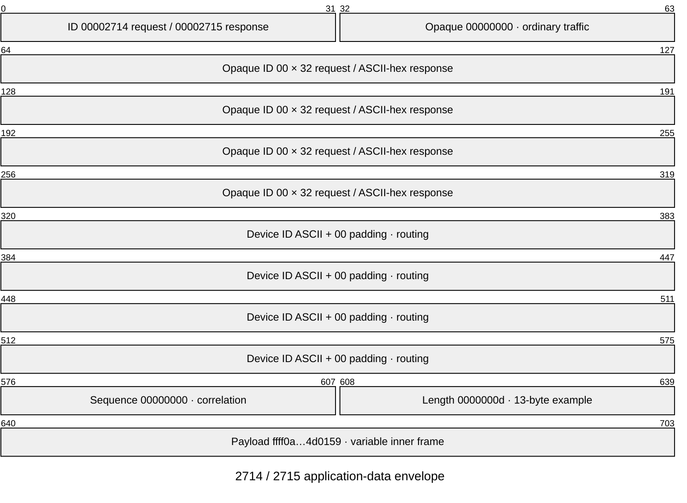
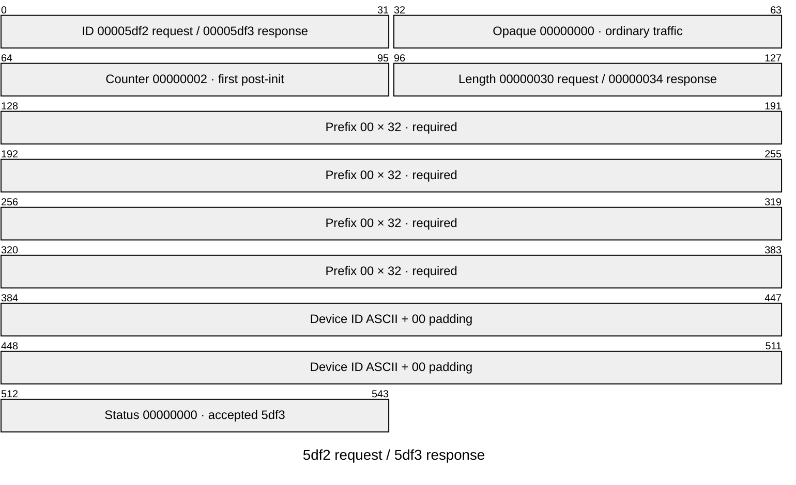
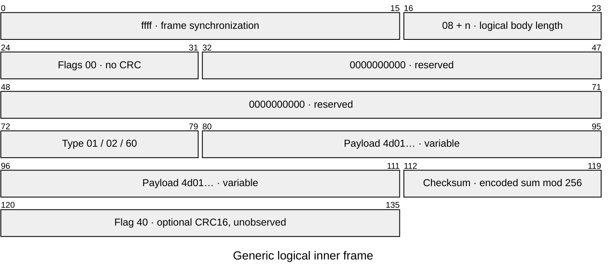
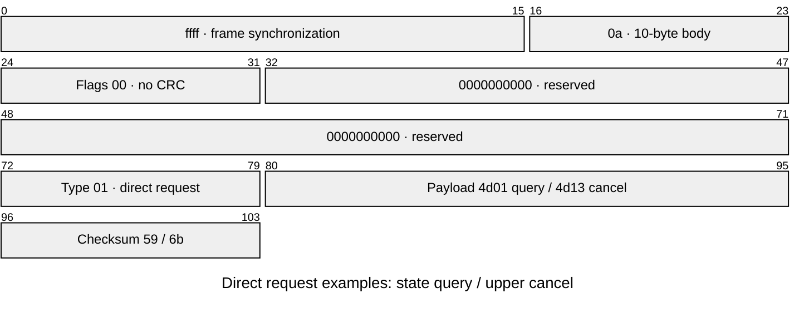
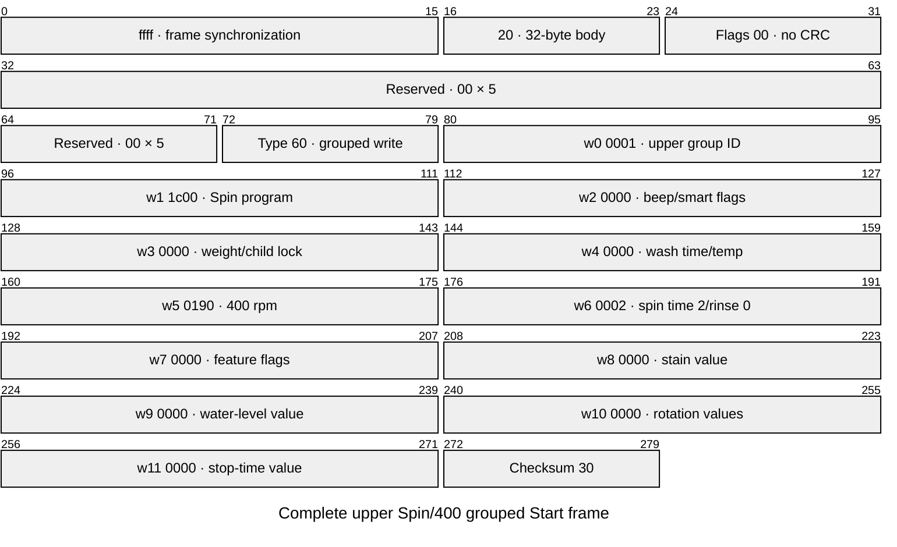
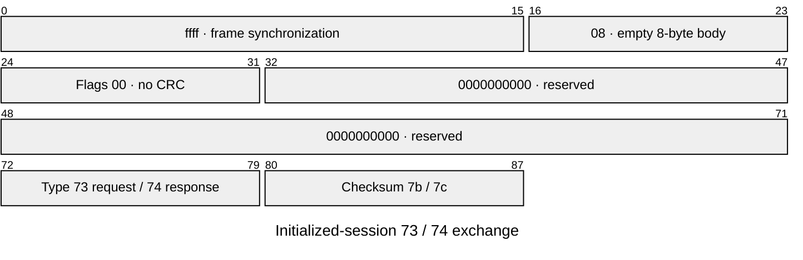
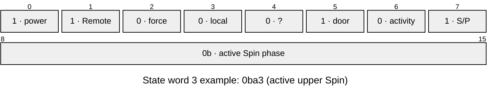
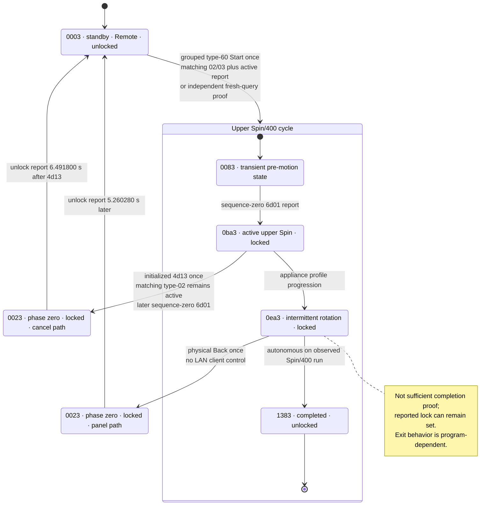

# Haier UHome Legacy UWT Protocol for HWD120-B1558U

> Copyright (c) 2026 U+ Reborn contributors. Licensed under
> [CC BY 4.0](LICENSE). When sharing this document or adaptations, attribute
> U+ Reborn contributors, link to
> `https://github.com/Zuz666/uplus-reborn`, link to the license, and indicate
> changes.

## Status and scope

This document specifies the LAN protocol observed on one Haier
HWD120-B1558U dual-drum washer-dryer used with the Euro Haier U+ 2.6.0
application. It is an interoperability specification for this exact model and
firmware family, not a claim about every Haier, UHome, Haismart, hOn, or
SmartHQ appliance.

The implementation is local-only at runtime. It does not require a Haier
account, TLS, AES, or a per-device `localKey` for the observed path. Device
identifiers, account data, APK contents, packet captures, and credentials are
not part of this document or the public fixtures. This document specifies only
the appliance wire protocol, state words, command encodings, and hardware or
source evidence; Home Assistant entity, draft, profile, action, and Recorder
behavior belongs in [`README.md`](../README.md) and
[`CONTRIBUTING.md`](../CONTRIBUTING.md).

Evidence labels used below:

- **WIRE** — repeated checksum-valid LAN captures establish the bytes.
- **HARDWARE** — WIRE data was correlated with the appliance panel or physical
  behavior.
- **PROFILE** — the exact model profile or application metadata describes the
  field, but a one-variable hardware capture has not verified its semantics.
- **HA report** — decoded device state retained in HA logs/state history; not
  necessarily accompanied by a synchronized raw packet capture.
- **OWNER** — an owner-reported panel or physical observation; its timing and
  scope remain separate from captured bytes.
- **UNKNOWN** — bytes exist, but assigning a user-facing meaning would be a
  guess.

PROFILE does not mean hardware-validated. Production controls may use inspected
exact-target source encodings with deterministic offline contracts; this does
not promote those programs or combinations to WIRE/HARDWARE evidence.

## Ecosystem boundary

Haier's historical [U+ announcement](https://www.haier.com/global/press-events/news/20150318_142653.shtml)
describes the broad ecosystem, but multiple incompatible LAN generations now
exist.

This appliance uses the older plaintext UWT envelope on TCP port `56800`. The
inner `FF FF` frame family agrees with the MIT-licensed
[HaierProtocol reference](https://github.com/paveldn/HaierProtocol/blob/d3334a1be24da142dd7fb68c6d2abfd628bfaded/doc/protocol_reference.rst).
HaierProtocol documents the inner frame family; it does not document this
washer's outer TCP envelope or appliance fields.

The AES/local-key uSS/HRDP protocol documented by
[Haismart Local](https://github.com/enapt/haismart-local/blob/main/PROTOCOL.md)
also uses TCP port `56800`, but it is a different transport. This washer's
captured sessions do not begin with a uSS HELLO and do not contain encrypted
application data. Port number alone is therefore not a protocol discriminator.

## Legacy LAN discovery

**WIRE + SOURCE, 2026-10-20:** the target answers legacy UDP discovery independently
of DHCP or cloud inventory. The pinned Euro U+ 2.6.0 APK/uSDK 4.0.9 establishes
the request builder and fixed legacy record layout. APK SHA-256:
`30fd548089468cddd9b5ccce04643f9529d70016e748141d04c70f593a0ced9e`.
These are independently described wire facts, not copied SDK implementation.

The discovery envelope is not the TCP UWT envelope:

| Offset | Bytes | Meaning |
| --- | --- | --- |
| 0 | 5 | ASCII `Haier` |
| 5 | 4 | Big-endian message ID |
| 9 | 2 | Big-endian flags |
| 11 | 6 | Unresolved header fields; zero in inspected traffic |
| 17 | 4 | Big-endian body length; total length is 21 + body length |

Request `0x6915` has a 56-byte body: a zero-filled 16-byte client identity
slot, NUL-padded `2.0.0` in eight bytes, and NUL-padded `UDISCOVERY_SDK` in
32 bytes. Send the 77-byte datagram to the interface's subnet broadcast on
UDP destination port `7083`.

The SDK `0x684d` handler copies a fixed 288-byte body independently of device
type. A complete datagram is 309 bytes. Source-established fields are:

| Datagram offset | Bytes | Meaning |
| --- | --- | --- |
| 21 | 16 | NUL-padded ASCII device identity |
| 37 | 32 | Binary type ID; display as 64 lowercase hexadecimal characters |
| 229 | 16 | NUL-terminated advertised IPv4 address |

Flags: bit 0 busy, bits 1–2 security mode, bit 3 ready-to-bind. These do not
establish physical power, Remote Control, door or cycle state. The legacy
record mapper assigns TCP port `56800`; this is not an advertised port.
Unresolved nickname/room/module buffers are not assigned invented meanings.
The separate source-defined `0x65f4` record and `0x684e` deletion messages
are not established by target hardware captures or decoded as `0x684d`.

The observed target type ID is
`111c12002400081005010021800088410000d500000000000000000000000000`.
All captured target records have security mode 0 and an advertised address
equal to the UDP sender. Discovery is unauthenticated and has no established
application checksum. Reject malformed lengths and inconsistent advertised
routing; use a separate checksum-valid TCP exchange to establish communication.

Receive on the sending socket as well as the fixed UDP/7083 path. Archived
traffic includes replies to UDP/7083. A fresh 120-second wired-host capture
recorded six broadcast requests and 40 replies, all addressed to the query
sender's ephemeral port, in four response windows. Bursts must be deduplicated;
a silent window is not proof of absence. Those captures describe one appliance
and one response payload variant, not all firmware or security modes.

The APK also browses `_cae._udp` over mDNS. No target-origin mDNS reply was
observed in the bounded multicast/direct checks; another device's CAE service
does not establish washer mDNS support.

## Layer model

```mermaid
flowchart TB
    MODEL["Layer 5 · typed application model<br/>immutable dual-drum snapshot · guarded intent · proven result"]
    EPP["Layer 4 · model-specific EPP message<br/>query · state/report · direct control · grouped control"]
    INNER["Layer 3 · legacy inner frame<br/>FF FF · stuffing · length · type · checksum"]
    UWT["Layer 2 · UWT envelope<br/>big-endian message ID · declared payload length · shared sequence"]
    TCP["Layer 1 · TCP byte stream<br/>port 56800 · arbitrary fragmentation and coalescing"]
    LIVE["Session liveness<br/>5df2 request · 5df3 response"]

    MODEL <-->|"intent ↓ · snapshot/report ↑"| EPP
    EPP <-->|"frame type + payload"| INNER
    INNER <-->|"2714 request ↓ · 2715 response/report ↑"| UWT
    UWT <-->|"encoded bytes"| TCP
    LIVE <-->|"heartbeat on the shared sequence"| UWT
```



Each layer has its own length and correlation rules. A TCP read is not a frame
boundary. Implementations must buffer arbitrary fragments and may receive
multiple complete envelopes in one read.

## UWT outer envelope

All integers are unsigned and big-endian.

For the verified HWD120-B1558U, the UWT device ID is the appliance's network
MAC address written as 12 uppercase hexadecimal ASCII characters without
separators. Its identity matches the DHCP client MAC and the captured UWT
envelope; it is not a cloud token, serial number or per-device encryption key.
The address can therefore be obtained from the local router without cloud
access. This identity mapping is specific to the verified model/path, not a
claim about every Haier protocol.

### Application-data request and response: `2714` / `2715`

Decimal message IDs `10004` and `10005` are `0x00002714` and `0x00002715`.
Their fixed header is 80 bytes.

| Offset | Width | Field | Contract |
|---:|---:|---|---|
| 0 | 4 | message ID | `2714` client request; `2715` device response/publish |
| 4 | 4 | opaque word | zero in ordinary observed traffic |
| 8 | 32 | opaque identifier | client zeroes it; device may return 32 ASCII hex bytes |
| 40 | 32 | device ID | ASCII followed by NUL padding |
| 72 | 4 | sequence | request/response correlation value |
| 76 | 4 | payload length | number of bytes after the header |
| 80 | variable | payload | one complete inner frame in observed traffic |

The header occupies bits `0..639`. The diagram's final 64-bit payload cell is a
schematic slot for a variable-length inner frame; its drawn width is not a
payload limit. The actual size is the `payload_length` field.



Total envelope length is `80 + payload_length`. The production decoder rejects
payloads over 4096 bytes before allocating or waiting for them.

A response to an explicit request is authoritative only when both conditions
hold:

1. the outer sequence equals the request sequence; and
2. the inner payload is a valid response for that request.

Sequence-zero `2715` packets are unsolicited device reports. They are state
events, not replies to a later non-zero request. An implementation must retain
or publish them without allowing them to satisfy the wrong request.

### Heartbeat: `5df2` / `5df3`

Decimal message IDs `24050` and `24051` are `0x00005df2` and `0x00005df3`.
Their fixed header is 16 bytes.

| Offset | Width | Field |
|---:|---:|---|
| 0 | 4 | message ID |
| 4 | 4 | opaque word; zero in observed traffic |
| 8 | 4 | shared request counter |
| 12 | 4 | payload length |
| 16 | variable | payload |

The final 32-bit field exists only in the accepted `5df3` response; a `5df2`
request ends after the padded device ID.



A client `5df2` payload is 48 bytes: 32 zero bytes followed by the ASCII device
ID padded to 16 bytes. An accepted `5df3` repeats those 48 bytes and appends a
four-byte device status, producing a 52-byte payload and 68-byte envelope.

Application-data requests and heartbeats share one monotonically increasing 32-bit
counter in an initialized session. Observed sessions use an approximately
five-second heartbeat interval.

In the full empty Spin/400 lifecycle capture, the Start connection began its
TCP close while a separate initialized read-only observer opened a new
connection. That observer completed its initial `4d01` and `73`/`74` exchange,
but its first counter-2 heartbeat received message ID `5def` whose payload
identified `5df2`, rather than the expected `5df3`. Identical heartbeat bytes
are accepted in other active and idle sessions. The exact `5def` semantics are
UNKNOWN; overlap with the preceding connection or a device cooldown is more
likely than malformed heartbeat framing. Do not retry a rejected persistent
session after a control. Use serialized short read sessions until reconnect
coexistence is independently verified.

## Inner `FF FF` frame

The logical frame before byte stuffing is:

```text
FF FF | L | flags | reserved[5] | frame_type | payload | checksum [| CRC16]
```

| Field | Width | Contract |
|---|---:|---|
| separators | 2 | literal `FF FF`; not included in `L` or checksum |
| `L` | 1 | `8 + payload_length`; allowed range `8..0xF1` |
| flags | 1 | zero in this model's observed frames |
| reserved | 5 | zero in generated and observed ordinary frames |
| frame type | 1 | transaction kind |
| payload | `L - 8` | EPP command and data |
| checksum | 1 | low byte of the encoded body sum |
| optional CRC16 | 2 | indicated by flag `0x40`; not observed or accepted here |

Mermaid packet diagrams require numeric ranges, so the generic diagram assigns
the variable payload a schematic 32-bit cell. The checksum and optional CRC
cells mean “immediately after the actual payload”; their displayed bit numbers
are not fixed wire offsets. Byte stuffing can further change physical offsets.



The fixed examples in [Sanitized complete inner-frame examples](#sanitized-complete-inner-frame-examples)
assign actual offsets and values.

### Byte stuffing and checksum

After the two separators, logical `FF` bytes in the length, header and payload
are encoded as `FF 55`. The checksum is the low eight bits of the sum of encoded
bytes from `L` through the end of the payload. Equivalently, sum the de-stuffed
logical body bytes and add `0x55` for each stuffed logical `FF`.

The APK-derived client encoder also encodes checksum `FF` as `FF 55`.
Device responses additionally use a **single terminal `FF` checksum**: twelve
complete captured responses independently validate this representation.
The decoder accepts either form at the checksum boundary only; a literal
checksum must be the final byte of the complete inner frame. Body escaping,
declared length, checksum equality and trailing-byte rejection remain strict.
CRC-bearing frames remain unsupported.

Observed captures contain no stuffed body byte. The implementation's stuffing
boundary is therefore defended by a synthetic fixture, not claimed as a
hardware observation.

### Observed frame types

| Type | Role | Evidence |
|---:|---|---|
| `01` | direct control/query | WIRE |
| `02` | correlated status | WIRE |
| `03` | grouped response/ACK | WIRE in some grouped Start sessions; not guaranteed |
| `04` | alarm/status family | WIRE; payload semantics incomplete |
| `05` | empty response, semantics unclassified | WIRE; matching grouped Start sequence, not accepted as ACK |
| `06` | unsolicited state report | WIRE |
| `60` | grouped profile write | WIRE for upper and lower Spin Start |
| `73` | empty initialization/alarm query | WIRE |
| `74` | matching initialization response | WIRE |

The exact captured empty type `05` frame is `ffff08000000000000050d`:
logical length `8`, no payload, checksum `0d`. It is checksum-valid, not a
corrupt type `03`. In one bounded upper Spin/400 capture it arrived 0.212169 s
after Start, followed by sequence-zero active type `06` at 2.764180 s, with
no matching `02`/`03` in that window. Its meaning remains unclassified.

A later Home Assistant Start confirmation failed at checksum offset 92 in a
93-byte inner frame. Its original bytes were not retained, but replaying the
twelve captured literal-`FF` responses reproduces the same decoder failure.
The checksum-boundary correction fixes those responses and the corresponding
Start confirmation path without changing raw type `05` classification, retrying
a write, or claiming retrospective confirmation of the original live command.

### Sanitized complete inner-frame examples

The state query and verified upper reset/cancel use the same direct-request
layout:



The grouped upper Start carries all 12 profile words in one complete type-`60`
frame:



Canonical serialized frames:

```text
State query:
ffff0a000000000000014d0159

Upper reset/cancel request:
ffff0a000000000000014d136b

Lower reset/cancel request:
ffff0a000000000000014d93eb

Verified upper Spin/400 grouped Start:
ffff200000000000006000011c00000000000000019000020000000000000000000030

Verified lower Spin/400 grouped Start:
ffff200000000000006000021c00000000000000019000020000000000000000000031
```

These examples contain no outer device identifier.

## Session and transaction model

### Short read

The proven read-only transaction is:

1. open TCP;
2. allocate sequence `0`;
3. send `2714` carrying frame type `01`, payload `4d01`;
4. accept the first checksum-valid `6d01` type `02` or type `06` whose outer
   sequence is `0`;
5. close TCP without retry.

A client may receive other valid sequence-zero reports while waiting for a
later non-zero query. Those reports remain events and must be queued in arrival
order.

### Initialized control session

The original U+ client and the independently verified local implementation use:

1. sequence `0`: `4d01` and a matching `6d01`;
2. sequence `1`: empty type `73` and a matching type `74`;
3. sequence `2` and later: control or heartbeat on the same shared counter.

The empty initialization pair contains no EPP payload:



Canonical request: `ffff08000000000000737b`.
Canonical response: `ffff08000000000000747c`.

Controls are serialized and dispatched exactly once. A matching type `02` or
`03` response is followed by an independent fresh postcondition report.
Unclassified raw `05` is never relabelled an ACK: a separate `4d01`, using a
fresh allocated sequence, may instead establish the requested state. If an
early query precedes the transition, further serialized state queries continue
at the existing confirmation interval within the original command deadline,
without depending on another unsolicited report. A candidate report alone is
not proof: a query reply must match its allocated sequence and independently
satisfy the postcondition. This neither resends the control nor accepts an
unrelated queued report as a query reply.

If confirmation is absent, or TCP fails after dispatch, the outcome is unknown,
not necessarily a failed write. A later ordinary poll may restore availability
without retrospectively confirming the earlier operation.

## EPP field coordinates

The model profile describes fields as:

```text
[label]^attribute#kind&value_map@write_metadata#response,word,bit,width$
```

For this profile:

- `word` is a 16-bit word index relative to the EPP command word;
- words are big-endian;
- bit zero is the least-significant bit;
- widths may span adjacent words;
- in the original inner frame, word `n` starts at byte `10 + 2*n`;
- `!` means the profile has no direct coordinate;
- grouped definitions pack many attributes into one write.

## `6d01` state block

A normal state payload begins with command word `6d01` and contains at least 41
big-endian words (82 bytes). The captured target uses words `0..40`.

The table is deliberately exhaustive at the block level. Exact-profile setting
definitions establish field coordinates without claiming independent physical
validation. Unmapped or semantically ambiguous coordinates are not interpreted
as active state; a writable field is not proof of a readable echo.

The following packet diagram uses logical EPP bit coordinates, numbered from
the least-significant bit. The 16-bit word itself is transmitted big-endian,
so this is a field-coordinate view rather than byte order on the wire.



| Word(s) | Bits | Attribute | Meaning | Evidence |
|---:|---:|---|---|---|
| 0 | 0..15 | — | command `6d01` | WIRE |
| 1 | 8..15 | `20500N` | upper selected program | WIRE; `0x1c` = Spin |
| 2 | 2 | `20501a` | upper delayed/reserved flag | PROFILE |
| 2 | 3 | `205005/6` | child/control lock setting | PROFILE; live reported-flag round trip, not physical panel-lockout proof |
| 2 | 8 | `20500l/m` | inverted buzzer-setting flag | PROFILE; live reported-flag round trip, not acoustic proof |
| 2 | 9 | `20501A` | upper smart-wash flag | PROFILE |
| 2 | 14 | `20500L/M` | water-reuse flag | PROFILE; decompiled app branch conflicts, so profile wins |
| 3 | 0 | `60500P` | appliance power | HARDWARE |
| 3 | 1 | `60500V` | physical Remote Control mode | HARDWARE |
| 3 | 2 | `6050ZV` | vendor force-delete flag | PROFILE |
| 3 | 3 | `60500Q` | local control lock | PROFILE |
| 3 | 5 | `605003` | upper reported door-lock flag | HARDWARE; not physical position or guaranteed latch state |
| 3 | 6 | `605004` | upper raw activity flag | UNKNOWN; remained zero during proven motion |
| 3 | 7 | `205003/4` | upper cycle-active / Start-Pause state | PROFILE; captured Spin and HA/panel pause-resume correlation; not motor motion |
| 3 | 8..15 | `605002` | upper program phase | PROFILE with target observations detailed under Program phases |
| 4 | 0..7 | `605008` | upper remaining hours | WIRE; applicable only outside phase zero |
| 4 | 8 | `605005` | upper raw door field | REJECTED as physical position; opening the door did not change it |
| 4 | 9..12 | `20500q/p/n/s` | upper completion-related flags | PROFILE |
| 4 | 13 | `2000ZC` | production-test flag | PROFILE |
| 4 | 14..15 | `605006/7` | upper rinse decrement/increment flags | PROFILE |
| 5 | 0..7 | `60500a` | upper raw hint code | PROFILE; diagnostic only |
| 5 | 8..15 | `605009` | upper remaining minutes | WIRE; suppressed in phase zero |
| 6 | 0..15 | `60500R` | upper cycle ordinal | PROFILE |
| 7 | 0..15 | `60500b` | upper cumulative cycle count | WIRE; scale is integer cycles |
| 8 | 0..15 | `60500c` | current/session water, unsigned 16-bit, reported L | PROFILE/WIRE; unit APK/OWNER |
| 9..10 | 0..31 | `60500d` | cumulative water, unsigned 32-bit, high word first, reported L | PROFILE/WIRE; unit OWNER |
| 11 | 0..15 | `60500e` | current/session energy, unsigned 16-bit, reported kWh | PROFILE/WIRE; unit APK/OWNER |
| 12..13 | 0..31 | `60500f` | cumulative electricity, unsigned 32-bit, high word first, reported kWh | PROFILE/WIRE; unit OWNER |
| 14 | 0..7 | `20500S` | upper reported rinse count | PROFILE/WIRE; seven observed at panel Start; later HA wash reports decrement |
| 15 | 0..7 | `20500U` | upper reported spin-stage time | PROFILE/WIRE; not selected RPM or a guaranteed immutable duration |
| 15 | 8..15 | `20500P` | upper configured clothing weight | PROFILE |
| 16 | 0..7 | `20500R` | upper reported wash-stage time | PROFILE/WIRE; includes applicable heating, not the original manual main-wash setting |
| 16 | 8..15 | `20500Q` | upper reported program temperature | PROFILE/WIRE; whole degrees, not measured water temperature |
| 17 | 0,1,2,3,5,6 | `20501b..g` | high-water, Easy Iron, super-clean, energy-save, soak, night flags | PROFILE; Easy Iron bit 1 stayed WIRE zero through the full Spin lifecycle |
| 18 | 8..15 | `20501h` | upper retained stain code | WIRE for Blood/Wine; ordinary mapping below, no proven active-stain flag; low byte remains UNKNOWN |
| 19 | 0..15 | `20500V` | source-declared upper spin-speed field | PROFILE only as selected-speed readback; zero in nonzero-speed references; do not confuse it with group word 5 |
| 20 | 0..7 | `60500q` | upper softener raw value | PROFILE |
| 20 | 8..15 | `60500r` | upper detergent raw value | PROFILE |
| 21 | 0..7 | `60500T` | upper measured clothing weight | PROFILE |
| 21 | 8..15 | `20501s` | upper wash rotation speed | PROFILE |
| 22 | 0..7 | `20501u` | upper wash stop time | PROFILE |
| 22 | 8..15 | `20501t` | upper wash rotation time | PROFILE |
| 23 | 0..15 | `20501v` | upper wash water level | PROFILE |
| 24 | 0..7 | `205018` | lower drying procedure | PROFILE |
| 24 | 8..15 | `20500Y` | lower selected program | WIRE; `0x1c` = Spin and `0x1f` = Bedding observed |
| 25 | 2 | `20501i` | lower delayed/reserved flag | PROFILE |
| 25 | 9 | `20501B` | lower smart-wash flag | PROFILE |
| 26 | 5 | `60500u` | lower reported door-lock flag | HARDWARE in Remote-Control standby and captured lower active/completed paths; not physical position |
| 26 | 6 | `60500v` | lower raw activity flag | UNKNOWN |
| 26 | 7 | `20500u/v` | lower cycle-active / Start-Pause state | PROFILE; HA/panel pause-resume correlation; not motor motion |
| 26 | 8..15 | `60500t` | lower program phase | PROFILE with target observations detailed under Program phases |
| 27 | 0..7 | `60500z` | lower remaining hours | WIRE; applicable only outside phase zero |
| 27 | 8 | `60500w` | lower raw door field | UNKNOWN; not exposed as physical position |
| 27 | 9..12 | `20500J/I/H/K` | lower completion-related flags | PROFILE |
| 27 | 14..15 | `60500x/y` | lower rinse decrement/increment flags | PROFILE |
| 28 | 0..7 | `60500B` | lower raw hint code | PROFILE; diagnostic only |
| 28 | 8..15 | `60500A` | lower remaining minutes | WIRE raw value; suppressed in phase zero |
| 29 | 0..15 | `60500S` | lower cycle ordinal | PROFILE |
| 30 | 0..15 | `60500C` | lower cumulative cycle count | WIRE; scale is integer cycles |
| 31 | 0..7 | `205013` | lower reported rinse count | PROFILE/WIRE; eight observed in panel-started Mix; later HA wash reports decrement |
| 32 | 0..7 | `205015` | lower reported spin-stage time | PROFILE/WIRE; decreased during Spin, not selected RPM |
| 32 | 8..15 | `205010` | lower configured clothing weight | PROFILE |
| 33 | 0..7 | `205012` | lower reported wash-stage time | PROFILE/WIRE; decreases during washing and includes applicable heating |
| 33 | 8..15 | `205011` | lower reported program temperature | PROFILE/WIRE; whole degrees, independent of the stain-code field |
| 34 | 0,1,2,3,5,6 | `20501j..o` | lower high-water, Easy Iron, super-clean, energy-save, soak, night flags | PROFILE |
| 35 | 8..15 | `20501p` | lower retained stain code | WIRE; six ordinary choices mapped below, may persist after panel clearing |
| 36 | 0..15 | `205016` | source-declared lower spin-speed field | PROFILE only as selected-speed readback; zero in nonzero-speed references |
| 37 | 0..7 | `60500N` | lower softener raw value | PROFILE |
| 37 | 8..15 | `60500O` | lower detergent raw value | PROFILE |
| 38 | 0..7 | `60500U` | lower measured clothing weight | PROFILE |
| 38 | 8..15 | `20501w` | lower wash rotation speed | PROFILE |
| 39 | 0..7 | `20501y` | lower wash stop time | PROFILE |
| 39 | 8..15 | `20501x` | lower wash rotation time | PROFILE |
| 40 | 0..15 | `20501z` | lower wash water level | PROFILE |

### Reported cycle-setting fields

Reported `6d01` cycle-setting words reflect the currently active or reserved
cycle on the appliance, regardless of whether it was started from the physical
panel, legacy app, or LAN client. A source default determines field
applicability for the active program only; it is never substituted for a
reported wire value.

Ordinary Standby, Completed, unknown program/phase, and missing settings carry
no active setting echo. Reported pending Start/reservation flags can establish
cycle context during a phase-zero transition, while paused and
intermittent-rotation cycles retain applicable reported values. Fixed program
settings remain readable in `6d01` even when the source UI does not allow
editing them before Start.

Temperature is the effective program target, not measured water temperature;
zero denotes unheated operation. Stage counters include applicable heating and
can decrease during execution; they cannot reconstruct original main-wash
minutes or selected RPM. The numeric delay mapping, useful selected-speed echo,
active-stain flag, and exact Smart fabric/stain identity remain unresolved.
Neither retained stain codes nor recipe arithmetic can fill those gaps.

The reported rinse coordinate can also decrease during a cycle: owner-operated
upper Casual and lower Mix washes produced successive counts from seven down to
one. It is not an immutable echo of the originally selected total. Exact
decrement boundaries remain unresolved; do not relabel it as a precisely
defined remaining-rinse counter.

### Execution state versus program phase

Decoded phase and cycle/reservation flags in `6d01` determine per-drum
execution state according to the following precedence:

| Report context | Execution state |
| --- | --- |
| Unsupported phase | Unknown |
| Completed or drying-finished phase, regardless of activity | Completed |
| Standby or delayed-start phase with reservation flag | Delayed |
| Standby without reservation or cycle activity | Standby |
| Active Standby without reservation, or delayed-start without reservation | Unknown |
| Other known operational phase with cycle activity | Running |
| Other known operational phase without cycle activity | Paused |
| Lost authoritative state | Unavailable |

Pausing retains the phase: observed panel Pause/Resume at phase `0x09` changes
execution Spinning/Running → Spinning/Paused → Spinning/Running, independently
for each drum. Intermittent rotation is still its own phase, not Completed.
This is contextual source-backed interpretation of `6d01` flags, not new
physical phase evidence or a direct motor-motion measurement.

### Consumption accounting contract

**PROFILE/APK:** The exact HWD120-B1558U profile (version 4.0.3 in U+ 2.6.0)
defines `60500c` through `60500f` with the identity `#1&1,0` transform.
Current water and electricity are unsigned 16-bit values at words 8 and 11;
cumulative water and electricity are unsigned 32-bit values at words 9–10
and 12–13, high word first. These are separate from the upper/lower cycle
counters (`60500b`, word 7; `60500C`, word 30). Target-model getters/setters
assign directly, and both drum view models receive the same four getters.
Their location among upper fields and their presentation in both views do not
establish upper-only ownership or independent per-drum counters.

**APK/WIRE/OWNER:** Target current-counter finish presenters stringify the
getter values without scaling. A synchronized naturally completed upper
Spin/400 run correlated current raw water `2` with U+ `2 Liter` and raw
electricity `1` with `1.0 kWh`. Cumulative L/kWh units are owner-confirmed.
An exact-target cumulative presenter and exact numeric cumulative-screen
correlation were not recovered; a single-drum presenter from another device
family is not evidence for this target. No `/10`, `/1000`, or Wh reinterpretation
is supported by the recovered target sources.

**Bounded observations, not universal accounting rules:**

| Observed path | Current fields | Cumulative fields and timing |
| --- | --- | --- |
| Lower Bedding natural completion | Water/energy stayed `3`/`0` | Raw `+62`/`+25` at lower completion |
| Lower Spin followed by owner-confirmed Stop | Water/energy `0`/`0` → `2`/`1` | Water `+2`, energy unchanged; lower cycle count unchanged |
| One empty upper Spin/400 natural completion | Raw water/energy `+3`/`+1` during `0x0e` | Same raw deltas during `0x0e`, one minute remaining, before `0x13` |
| Another upper Spin/400 natural completion | No complete per-cycle coverage inferred | Water committed during `0x0e`, one minute remaining; energy unchanged through `0x13` and reported unlock |
| Concurrent upper Quick wash and lower timed Dry | Raw water/energy `19`/`0` → `33`/`29` at first upper `0e`; unchanged at first lower `0e` | Water `+14` at upper `0e`, then water/energy `+4`/`+30` at lower `0e`; both cycle counts still unchanged |

The stopped lower Spin returned to U+ Standby without an End-consumption
presenter. These observations establish neither complete whole-appliance
coverage nor a universal per-cycle, upper-only, commit-at-zero, or
commit-at-`Completed` rule. The owner observed accumulation between programs,
session reset on panel power-off, and possible loss of pending cumulative
updates on that path. Persistence across mains loss is unknown.

### Remaining-time invariant

The appliance retains non-display values in the raw time words while a drum is
in phase zero. Therefore:

```text
remaining_minutes = hours * 60 + minutes, only when phase != 0
remaining_minutes = absent, when phase == 0
```

Publishing the retained raw value in standby creates a false countdown.

### Extended `7d01` / `7d02` fields

The exact profile also declares extended reports. Their framing has not been
captured on this target, so all rows remain PROFILE:

| Response | Word(s), bits | Attribute | Meaning |
|---|---|---|---|
| `7d01` | 8, 0..15 | `7050a0` | upper current water raw value |
| `7d01` | 9..10, 0..31 | `7050a1` | upper cumulative water raw value |
| `7d01` | 11, 0..15 | `7050a2` | upper current electricity raw value |
| `7d01` | 12..13, 0..31 | `7050a3` | upper cumulative electricity raw value |
| `7d01` | 16, 8..15 | `70500Q` | upper configured wash temperature |
| `7d01` | 25, 8..15 | `7050a4` | upper measured wash temperature |
| `7d02` | 10, 8..15 | `705011` | lower configured wash temperature |
| `7d02` | 19, 8..15 | `7050a5` | lower measured wash temperature |

## Program values

The profile encodes a program value as an index and represents it textually as
`30500` plus a base-62-like alphabet character. Production supports all 12 upper
and 20 lower programs below from the inspected exact-target builders. Historical
Spin captures and the representative live runs in the
[supported-command matrix](#supported-command-matrix) add bounded physical/HA
evidence; they are not exhaustive validation of every program or combination.
Program names retain exact-target PROFILE provenance even when a run is observed.

### Upper drum

| Value | Code | Label | Evidence |
|---:|---|---|---|
| `0x07` | `305007` | Kids' Wear | PROFILE |
| `0x09` | `305009` | Allergy Care | PROFILE |
| `0x0d` | `30500d` | Drum Clean | PROFILE |
| `0x0e` | `30500e` | Underwear | PROFILE |
| `0x0f` | `30500f` | Quick Wash | PROFILE; representative live HA run |
| `0x13` | `30500j` | Delicate Care | PROFILE |
| `0x14` | `30500k` | Baby Care | PROFILE |
| `0x15` | `30500l` | Casual | PROFILE; representative live HA runs |
| `0x18` | `30500o` | Colored Laundry | PROFILE |
| `0x1a` | `30500q` | Towels | PROFILE |
| `0x1b` | `30500r` | Rinse+Spin | PROFILE |
| `0x1c` | `30500s` | Spin | WIRE/HARDWARE |

### Lower drum

| Value | Code | Label |
|---:|---|---|
| `0x01` | `305001` | Cotton |
| `0x02` | `305002` | Synthetic |
| `0x03` | `305003` | Down |
| `0x04` | `305004` | Curtain |
| `0x05` | `305005` | Mix |
| `0x06` | `305006` | Shirts |
| `0x09` | `305009` | Hygiene |
| `0x0a` | `30500a` | Wool |
| `0x0b` | `30500b` | Jeans |
| `0x0c` | `30500c` | Refresh |
| `0x0d` | `30500d` | Drum Clean |
| `0x0f` | `30500f` | Quick Wash |
| `0x11` | `30500h` | Bulky |
| `0x12` | `30500i` | Sports Wear |
| `0x13` | `30500j` | Delicate Care |
| `0x1b` | `30500r` | Rinse+Spin |
| `0x1c` | `30500s` | Spin |
| `0x1d` | `30500t` | Dry |
| `0x1f` | `30500v` | Bedding |
| `0x20` | `30500w` | Outdoor Care |

Lower Spin `0x1c` and Bedding `0x1f` have WIRE/HARDWARE state observations;
C8 separately captured empty lower Spin/400 Start and `4d93` Cancel.
Later live HA runs also observed Mix, Rinse+Spin, smart Delicate Care and Dry.
These observations supplement the source-derived labels without establishing
exhaustive hardware coverage. Implementation support follows the exact-target
builders; a state observation alone is not a control-command capture.

The exact APK profile defines per-program defaults and allowed main-wash
duration, temperature, rinse count and spin speed. The protocol encoder
preserves this matrix in typed capabilities and validation. Builder
transformations include temperature-dependent heating time and program/option
duration adjustments; UI minutes are not blindly copied into every wire
duration. Offline encoder coverage is distinct from physical proof.

The lower drying byte has six source-defined coordinates: off `0`/`305000`,
auto `10`/`30500a`, and 30/60/90/120 minutes as values `7/6/5/4` and codes
`305007/6/5/4`. U+'s per-program map further removes off for Dry and removes
every mode except 30 minutes for Refresh; programs whose drying function is
excluded expose none.

The raw delay coordinate space is `0..48` half-hour steps, but this is not the
UI choice list. For each delay-capable program U+ adds off `0`, then whole-hour
end times from `ceil(source cycle minutes / 60)` through 24 hours. Programs
whose delay function is excluded expose no delay choice. Delay and drying are
implemented from source, but their complete physical behavior remains unverified.

Group word 7 exposes six APK booleans per drum: high water, Easy Iron,
intensive/super-clean, eco, soak, and night. APK UI maps provide exact
per-program inclusion/exclusion lists for those functions, plus delay and
lower-drum drying; diagnostics preserve both the semantic names and profile
attribute IDs. This proves individual UI availability only. It does not prove
that two offered options are compatible together or that the appliance accepts
their grouped write.

The smart-wash path offers 19 upper and 24 lower fabric IDs and 30 named
`W1..W30` stain rows. It derives an ordinary program, applies the source
priority ordering to selected stains and then the material's source limits.
The source stain object's `level` is a recipe priority, not an ordinary stain
wire enum. Smart mode does not independently maximize every selected row.
Its presenter disables manual scalar and extra-option edits; the public
action rejects such overrides rather than silently ignoring them.

The HWD120-B1558U owner's manual, printed pages 18–19 and §7.10.2 on page 29,
also documents six ordinary stain choices for upper Kids wear/Casual and lower
Cotton/Mix/Synthetic. These are implemented independently of Smart fabric:

| Ordinary stain | Wire code | Recipe temperature, °C | Wash-stage construction |
| --- | ---: | --- | --- |
| Blood | 1 | 60 | 9 minutes plus exact-program source heating |
| Grass | 2 | 60 | 10 minutes plus exact-program source heating |
| Wine | 3 | Lower 50; upper 55 | Lower 25; upper 35 minutes, observed complete stage totals |
| Juice | 7 | 30 | 10 minutes plus exact-program source heating |
| Soil | 5 | 60 | 40 minutes plus exact-program source heating |
| Milk | 6 | 30 | 40 minutes plus exact-program source heating |

All six lower Mix panel references and upper Casual Blood/Wine references
were read on hardware on 2026-10-18. The earliest lower Blood report was
49 minutes, matching 9 + 40; upper Casual reported 39, matching 9 + 30.
Wine does not follow the corresponding Smart-row arithmetic, so its paired
per-drum observed totals are used instead. Other supported program combinations
remain source-derived/reference-transfer coverage, not full native-panel parity.
Compatible Intensive adds the existing source time allowance.

Ordinary stains own temperature and complete wash-stage time. There is no
invented reverse mapping to an original user-selected main-wash duration.
Selecting an ordinary stain excludes Eco/Night/Soak and manual temperature or
main-wash overrides; clearing the stain restores program temperature and
main-wash defaults.

A panel no-stain Mix run retained the previous Blood code. Separate grouped
Starts verified explicit clearing to zero and changing zero to Wine while
independently supplied temperature/time remained unchanged. Thus a retained
code is not proof of active stain removal, and changing the enum alone does
not reproduce the panel recipe. The HA encoder supplies both the enum and
effective recipe. It writes the chosen ordinary code, or explicit zero for
no ordinary stain, instead of inheriting the previous tag. Smart `W` IDs are
never substituted for ordinary wire codes. Neutral clearing was physically
checked on lower Mix; the broader encoding has offline contract coverage.

Refresh is a source quirk: its UI offers only 30-minute drying, but its command
builder skips the drying setter and preserves the reported byte. The encoder
does the same. A successful Refresh operation therefore explicitly lists
`drying_mode` among its unconfirmed settings.

## Program phases

The profile supplies generic labels for all phase codes. Hardware evidence is
narrower and takes precedence for this target.

| Value | Profile label | Target interpretation | Evidence |
|---:|---|---|---|
| `00` | Standby | standby / non-active | HARDWARE |
| `01` | Weighing | observed at upper Casual/Eco Start; not an independent load measurement | Live UWT state |
| `02..06` | Washing substeps | `05` during lower Bedding, upper Quick wash, lower smart wash and initial timed Dry | WIRE/HARDWARE for `05`; labels are not program-exclusive |
| `07..0a` | Spinning substeps | lower `09` during Bedding and Rinse + Spin | WIRE/HARDWARE for `09`; other values PROFILE |
| `0b` | Spinning | active locked Spinning for upper Spin, lower Bedding, and lower Spin | HARDWARE |
| `0c` | Drying | observed during lower timed Dry/30 after initial phase `05` | Live UWT state; heater operation not independently measured |
| `0d` | Cooling | unverified | PROFILE |
| `0e` | End washing | `intermittent_rotation`; not sufficient wire-completion proof; exit is program-dependent | HARDWARE |
| `0f` | Time-delay running | upper delayed Quick wash, delay-active, 60 reported minutes for the selected one-hour finish delay | Live UWT state; not a universal exact-delay echo |
| `10` | Intermittent tumbling | `intermittent_rotation`; observed in both drums during owner-operated washes with Easy Iron enabled | HA report / OWNER; owner interrupted the stage, not autonomous-completion proof |
| `11` | Drying | unverified | PROFILE |
| `12` | Drying finished | unverified | PROFILE |
| `13` | Intermittent tumbling finished | completed phase; observed for upper Spin/Quick wash and lower Bedding; lock and cycle-active flags may remain set | WIRE/HARDWARE; not a physical-door guarantee |
| `14` | Intermittent tumbling | unverified | PROFILE |

The critical hardware correction is phase `0e`. During an empty upper Spin/400
cycle, the panel displayed “Вращение с перерывами” (intermittent rotation), the
door remained locked, and the drum continued periodic tumbles. The explicit
Easy Iron option was zero in both the grouped request and state word 17 bit 1.
Phase `0e` must not be exposed as `finished` or used as a completion
postcondition. In one untouched upper Spin/400 run it later reached unlocked
word `1383` / phase `13` and U+ End autonomously. The owner has observed other
programs remain in intermittent rotation for a very long time without natural
completion, so that transition must not be generalized by phase alone.

Later synchronized evidence limits any universal End-to-phase mapping. The
recovered U+ main screen showed upper Spin / End at `10:59:56.291417Z`,
bracketed by successful reads reporting `0e`, one minute, and lock set. First
`13` was observed at `11:03:19.716483Z`, still with lock set; the first
`13` with lock clear followed at `11:03:23.244482Z`. Owner physical observations
and reported flags disagreed. Preserve those observations separately: U+ End
does not universally mean `13`, and `13` does not guarantee lock clear.
Reported lock bits are appliance status flags, not physical door position or a
guaranteed latch state.

An upper cold Quick wash with zero rinses and selected zero RPM followed
`05 -> 0b -> 0e -> 13` without another upper command. This neither proves
zero physical RPM nor makes phase `0b` a speed measurement. Its cycle count
increased by one; completed-state Reset then restored standby while lower
Dry remained active. Reported lock flags remained set after Reset/Cancel.

The observed lower Bedding path was locked `05`/Washing at 120 minutes,
locked `09`/Spinning at 90 minutes, locked `0b`/Spinning at six minutes, then
unlocked `13`/Completed at zero. Its physical Start preceded capture, so this
state evidence does not authorize any lower write.

The observed lower Spin path was locked `0b`/Spinning with a six-to-one-minute
countdown, then locked `0e`/intermittent rotation. One confirmed U+ Stop returned
it to phase-zero Standby. The emulator delivered Start and Stop through opaque
cloud TLS: every decoded plaintext LAN request in that capture was read-only
`4d01`. At the time this revealed no lower command body and left the lower
local Start/`4d93` write gate closed. C8 (2026-08-01) later closed that gap on
the bridged `-wifi-tap` emulator: U+ sent the lower grouped Start (group
`0002`) and the first plaintext local `4d93` cancel for the same empty lower
Spin/400 profile, restoring Standby.

## Verified state transitions

The hexadecimal values are complete state word 3 values, not phase bytes. They
combine global flags, reported lock state, source-defined cycle-active bit 7,
and upper phase. Cycle-active is not a universal motion measurement.
Here “locked/unlocked” means the reported flag, not physical position. The two `0023` nodes deliberately
show distinct observed exit paths. The direct `0e` to unlocked `13` edge
summarizes an earlier sampled run; later captures also show locked `13` first.



The physical Back transition is local panel input. It is not a `4d13` command.

## Controls

### Supported-command matrix

Implementation support and physical evidence are separate axes. The broader
source-backed implementation does not rewrite the historical capture envelope.

| Surface | Implemented production behavior | Physical evidence / limit |
|---|---|---|
| State query `4d01` | Read-only polling | Correlated checksum-valid `6d01` |
| Upper/lower grouped Start `0001`/`0002` | All 12 upper / 20 lower programs, scalar settings, six ordinary option switches and supported stain recipes | Spin captures plus live HA upper Casual/Eco and Quick wash, lower Rinse + Spin/high water and timed Dry; not an exhaustive hardware matrix |
| Smart fabric/stain Start | Exact-target recipes, including multiple stains | Live HA lower A1 with W1/W30 confirmed Delicate care, smart flag and recipe settings |
| Ordinary-program stain removal | Six complete recipes on the manual-supported programs, independent of Smart; explicit clearing and conflict handling | Six lower Mix panel references, upper Casual Blood/Wine and lower enum clearing/change verified; remaining combinations source-derived/reference-transfer |
| Upper pause/resume/cancel | Direct `4d05`/`4d04`/`4d13` | Empty Spin captures and live HA Casual lifecycle; delayed Quick wash Cancel |
| Lower pause/resume/cancel | Direct `4d85`/`4d84`/`4d93` | Spin Cancel capture; live HA Rinse + Spin lifecycle, smart-wash and Dry Cancel |
| Completed-state Reset | `4d13`/`4d93` with distinct completed-state preconditions | Upper Quick wash Reset live-confirmed; lower completed Reset source/offline evidence |
| Power, buzzer, child lock | Typed shared switches/actions; power disabled by default | Buzzer and Child lock flag round trips live-confirmed, physical effects unverified; power-off loses physical Remote Control |
| Water reuse and standalone program setter | No public control | Profile identifiers alone do not establish an exact-target UI path |

### Direct command identifiers

| Intent | Attribute | Inner command | Status |
|---|---|---:|---|
| query state | `2000ZZ` | `4d01` | WIRE/HARDWARE |
| power on | `205001` | `4d02` | Implemented; PROFILE, no guaranteed offline wake |
| power off | `205002` | `4d03` | Implemented; PROFILE, removes Remote Control |
| upper resume | `205003` | `4d04` | Implemented; captured upper Spin and live HA Casual |
| upper pause | `205004` | `4d05` | Implemented; captured upper Spin and live HA Casual |
| child lock / unlock | `205005/6` | `4d06/4d07` | Implemented; live reported-flag round trip, not physical panel-lockout proof |
| buzzer on/off | exact-target source | `4d2e/4d2f` | Implemented; live reported-flag round trip, not acoustic proof |
| water reuse on/off | `20500L/M` | `4d0d/4d0e` | PROFILE only; not exposed |
| upper program setter | `20500N` | `5d03` + encoded value | PROFILE; new cycles use the grouped builder |
| lower resume / pause | `20500u/v` | `4d84/4d85` | Implemented; live HA Rinse + Spin |
| lower program setter | `20500Y` | `5d83` + encoded value | PROFILE; new cycles use the grouped builder |
| upper reset/cancel | `20501q` | `4d13` | Implemented; captured Spin Cancel, live Casual/delayed Cancel and completed Quick wash Reset |
| lower reset/cancel | `20501r` | `4d93` | Implemented; captured Spin Cancel and live ordinary/smart/Dry Cancel; completed Reset remains source/offline evidence |

An idle state may retain a non-zero upper program. Captures prove U+ still uses
a grouped new-cycle Start in that state. A client must not select direct `4d04`
merely because `program_value != 0`.

Pause and resume are direct `4d05`/`4d04` commands (C9 verified U+ emits resume
twice). The captured paused upper Spin retains phase `0b` while word 3 changes
`0ba3 -> 0b23 -> 0b03`; resume returns through `0b83 -> 0ba3`. Bit 5 is the
reported lock flag. Exact-target source identifies bit 7 as cycle active:
it supports lifecycle decisions, not a universal motor-motion sensor.
Neither flag proves physical door position or guarantees latch state.

### Upper grouped write `0001`

Frame type `60` carries a 12-word read-modify-write profile group:

| Group word | Field(s) |
|---:|---|
| 0 | group ID `0001` |
| 1 | program bits 8..15; reservation/delay bits 0..7 |
| 2 | inverted buzzer bit 0; smart-wash bit 1 |
| 3 | clothing weight bits 0..7; child-lock bit 10 |
| 4 | effective wash-stage time, including applicable heating, bits 0..7; temperature bits 8..15 |
| 5 | spin speed bits 0..15 |
| 6 | spin time bits 0..7; rinse count bits 8..15 |
| 7 | high-water bit 0; Easy Iron bit 1; super-clean bit 2; energy-save bit 3; soak bit 5; night bit 6 |
| 8 | ordinary stain code bits 8..15; explicit zero when no ordinary stain is selected |
| 9 | wash water level bits 0..15 |
| 10 | wash rotation time bits 0..7; wash rotation speed bits 8..15 |
| 11 | wash stop time bits 8..15 |

The first hardware-verified group is this 12-word payload:

`0001 1c00 0000 0000 0000 0190 0002 0000 0000 0000 0000 0000`.

Its complete inner frame is diagrammed in
[Sanitized complete inner-frame examples](#sanitized-complete-inner-frame-examples).

It means upper Spin, 400 rpm, profile spin-time value 2, with all represented
option bits zero. The speed word is raw big-endian rpm at the discrete upper
speeds captured: `0x0190` (400), `0x0258` (600), `0x03e8` (1000), and
`0x04b0` (1200). C9/C10 observed default cycle times of 6/6/7/8 minutes;
this does not verify arbitrary intermediate speeds or lower speeds beyond 400.
Some sessions contain a matching type `02` state response or type `03` grouped
ACK. Later captures instead contain matching empty raw `05` and active `06`,
without matching `02`/`03`. There is no every-write-response guarantee.
Production never treats raw `05` as an ACK. Its alternative proof is a separate
fresh-sequence query and the requested postcondition, without a control retry.

### Lower grouped write `0002`

The lower group layout mirrors the upper one, adding the drying procedure in
word 2. C8 (2026-08-01) verified this exact 12-word payload on the wire from
U+ on the bridged emulator:

`0002 1c00 0000 0000 0000 0190 0002 0000 0000 0000 0000 0000`.

It means lower Spin, 400 rpm, profile spin-time value 2, with all represented
option bits zero, and differs from the upper Start only in the group ID. C8
observed no grouped ACK; its direct type-`02` state response and fresh type-`06`
active report provide bounded evidence of the Start transition, not natural
cycle completion. The current generic lower intent can encode this payload.

| Group word | Field(s) |
|---:|---|
| 0 | group ID `0002` |
| 1 | program bits 8..15; reservation/delay bits 0..7 |
| 2 | inverted buzzer bit 0; smart-wash bit 1; drying procedure bits 8..15 |
| 3 | clothing weight bits 0..7; child-lock bit 10 |
| 4 | effective wash-stage time, including applicable heating, bits 0..7; temperature bits 8..15 |
| 5 | spin speed bits 0..15 |
| 6 | spin time bits 0..7; rinse count bits 8..15 |
| 7 | high-water bit 0; Easy Iron bit 1; super-clean bit 2; energy-save bit 3; soak bit 5; night bit 6 |
| 8 | ordinary stain code bits 8..15; explicit zero when no ordinary stain is selected |
| 9 | wash water level bits 0..15 |
| 10 | wash rotation time bits 0..7; wash rotation speed bits 8..15 |
| 11 | wash stop time bits 8..15 |

### Completion contracts

A matching packet is not enough to report success.

- **Start, either drum:** prove the target program and active or delayed-start
  transition, retaining required shared flags. Phase names are not
  program-exclusive: a timed lower Dry run first reported active phase `05`
  before reaching Drying phase `0c`. Compare observable reported settings with
  the exact once-encoded group: temperature, rinses, spin-time, applicable
  option bits, smart mode, lower drying byte and the ordinary stain coordinate
  for programs offering ordinary stains, including explicit zero when none is
  selected. The builder places Dry duration in the command's wash-time
  coordinate, but the reported main-wash coordinate is zero; confirm the
  selected drying byte and zero main-wash value instead of demanding a
  duration echo there. Standby, completed, unknown and inconsistent delay
  states do not prove Start. The other drum need not be idle.
- **Settings without an echo:** captured Spin reports leave profile speed
  words 19/36 at zero even for accepted 400/1200 RPM writes. Do not invent a
  speed read-back or reject those accepted starts for lacking it. Diagnostics
  list `spin_rpm` when selected and `delay_half_hour_step` when a delay is
  selected as unconfirmed. Refresh additionally lists `drying_mode`, because
  source UI choice and preserved wire byte are not equivalent.
- **Pause/resume:** require the target cycle-active flag to clear/set while
  retaining the program and relevant phase. Do not demand a lock transition
  that every program has not promised.
- **Cancel/reset:** require target phase-zero standby with cycle-active clear.
  Captured upper active cancel passed through `0ba3 -> 0023 -> 0003`; paused
  cancel passed directly `0b03 -> 0003`. These examples do not make draining
  or physical unlock a universal cancel postcondition.
- **Shared options:** require the corresponding authoritative power, buzzer
  or child-lock setting flag, not proof of an acoustic or panel-lockout effect.
  The manual describes the child-lock symbol appearing one minute after Start.
  Enabling the setting in standby can set both child-lock and local-lock flags;
  Child lock off must remain possible when both are set. A local-lock flag
  without Child lock enabled does not receive that exception. Power-off may
  disconnect before proof; report uncertainty rather than fabricating success
  or an offline wake capability.
- **Unknown outcome:** absent response/postcondition proof or a disconnect
  after dispatch is uncertain, not proof of failure. Ordinary polling may
  recover state; it neither repeats the write nor changes its recorded outcome.

## Safety and concurrency invariants

1. Read current state immediately before constructing a control.
2. Reject meaningful target/shared revision changes; ignore normal countdown,
   consumption counters and unrelated drum progress.
3. Serialize all local intents from one client and re-check control opt-in.
4. Never expose arbitrary packet sending in production.
5. Start requires a valid exact-target intent, target standby, power, physical
   Remote Control and applicable source lock constraints. Do not require the
   other drum to be idle or claim a raw door field proves physical closure.
6. All advertised programs/options are source-backed implementation scope;
   physical captures remain bounded evidence, not an implementation allowlist.
   Cancel is not a promise about retained water or safe physical door opening.
7. Power-off is not a cancel primitive. It removes physical Remote Control and
   cannot be restored remotely on this model.
8. A disappeared response is `unavailable`, not evidence of `power=false`.
9. Raw door fields and reported lock flags do not prove physical door position
   or guarantee latch state. Physical checks remain separate.
10. After a control session, use serialized short `4d01` reads until persistent
    reconnect/coexistence is separately proven.

## Known unknowns and required captures

The following are intentionally unspecified rather than guessed:

- phase substeps other than the narrow hardware mappings above;
- exact early-cycle phase timing beyond the bounded captures;
- physical behavior for unobserved programs/combinations, beyond the
  representative non-Spin lifecycle and shared-setting flag transitions above;
- acoustic effects of buzzer settings and physical panel lockout from Child lock;
- the meaning of matching empty raw type `05` and the conditions selecting
  grouped response types;
- drainage and safe physical door opening after cancellation;
- calibrated load/detergent/softener measurements and exact physical duration
  behavior beyond the inspected source encoder;
- semantics of raw bit-6 activity flags, hint codes, raw door fields, `5def`,
  and unassigned bits; bit-7 cycle activity is a separate implemented contract;
- per-program option capability matrices on live hardware;
- `7d01`, `7d02`, alarm payloads, and all 96 profile alarm meanings;
- persistent overlapping U+/HA sessions beyond verified serialized short-session coexistence;
- discovery security/busy transitions, other record variants and target mDNS support.

Missing physical evidence does not remove an otherwise implemented,
source-backed program. Unknown encodings or meanings are not invented.

## Implementation and fixtures

The public implementation is embedded under
[`custom_components/uplus_reborn/protocol`](../custom_components/uplus_reborn/protocol/).
Synthetic, sanitized protocol contracts are in
[`tests/test_commands.py`](../tests/test_commands.py),
[`tests/test_protocol.py`](../tests/test_protocol.py) and
[`tests/test_response_contract.py`](../tests/test_response_contract.py). They
contain no account, device, APK, or unsanitized packet-capture material.

The implementation deliberately has no generic raw-write interface. Its public
surface is immutable state/capabilities, `ProgramIntent`, `start_program`,
`control_drum` and `set_appliance_option`. Callers never construct raw frames.

Protocol logs and exception-derived diagnostics never include hosts,
device/account identifiers, tokens, opaque UWT identifiers or full frames.
Error causes come from a fixed classification, never arbitrary exception text.
Malformed-frame context is restricted to bounded, allowlisted integer offsets
and lengths. Inner offsets count encoded bytes from the initial `FF FF`;
`inner_declared_length` is the decoded body-length field, while
`inner_received_length` includes the encoded marker/body/checksum. Envelope
declared lengths count payload bytes; partial-envelope received lengths include
the buffered header. State-payload lengths exclude the inner frame header.
These structural values explain a parser rejection without retaining packet
contents or relaxing escape, checksum, length or response-type validation.
