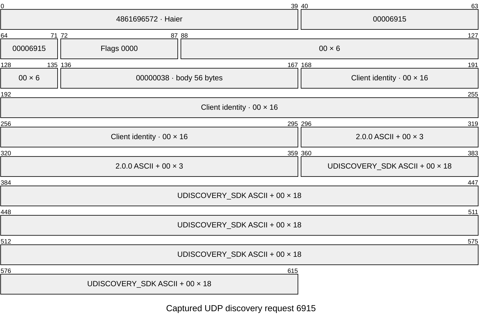
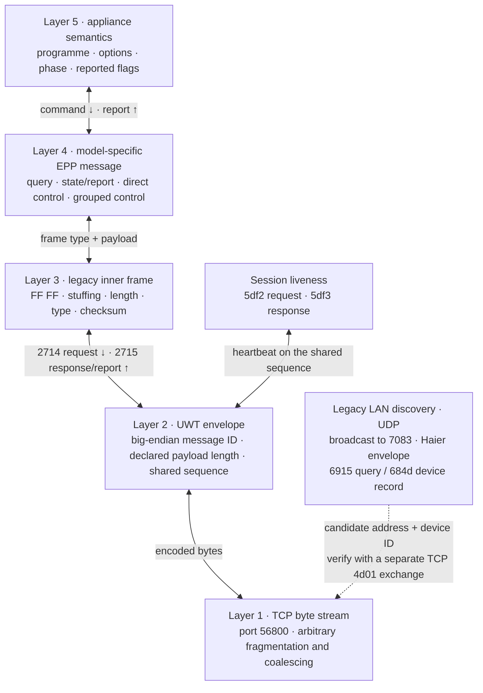
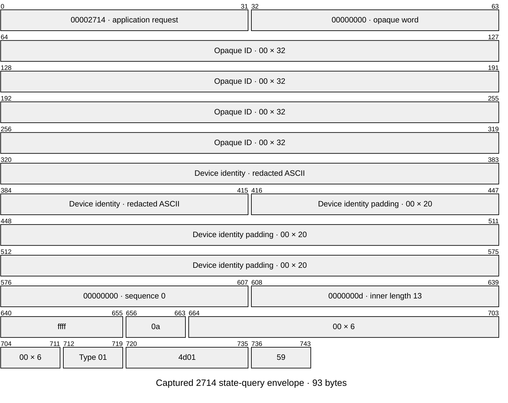
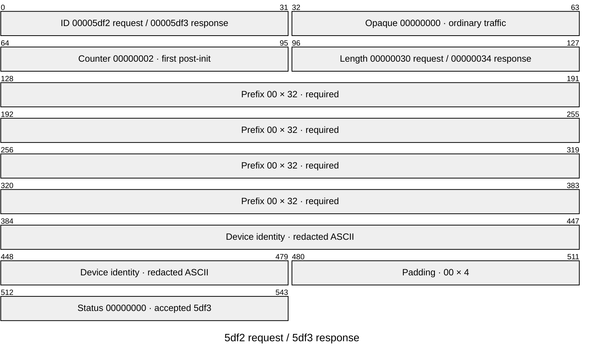
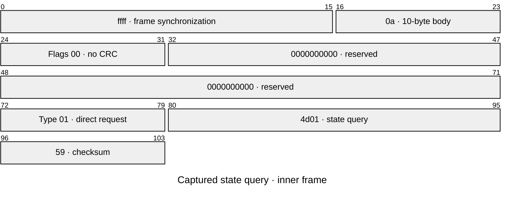
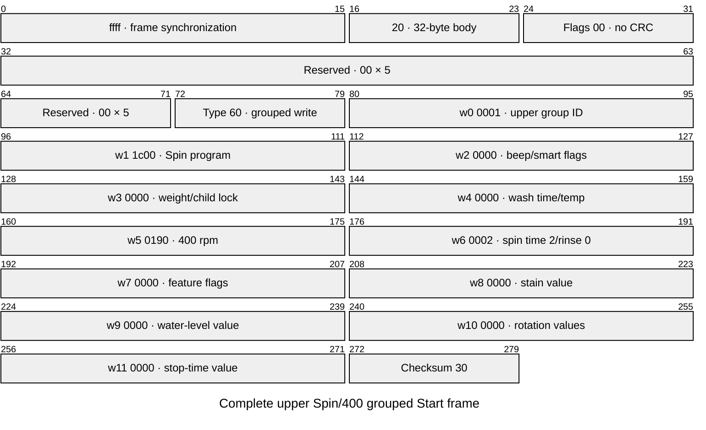
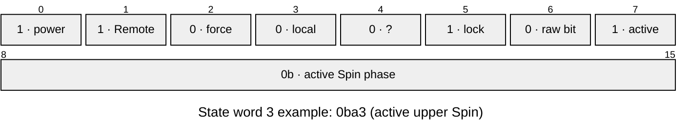
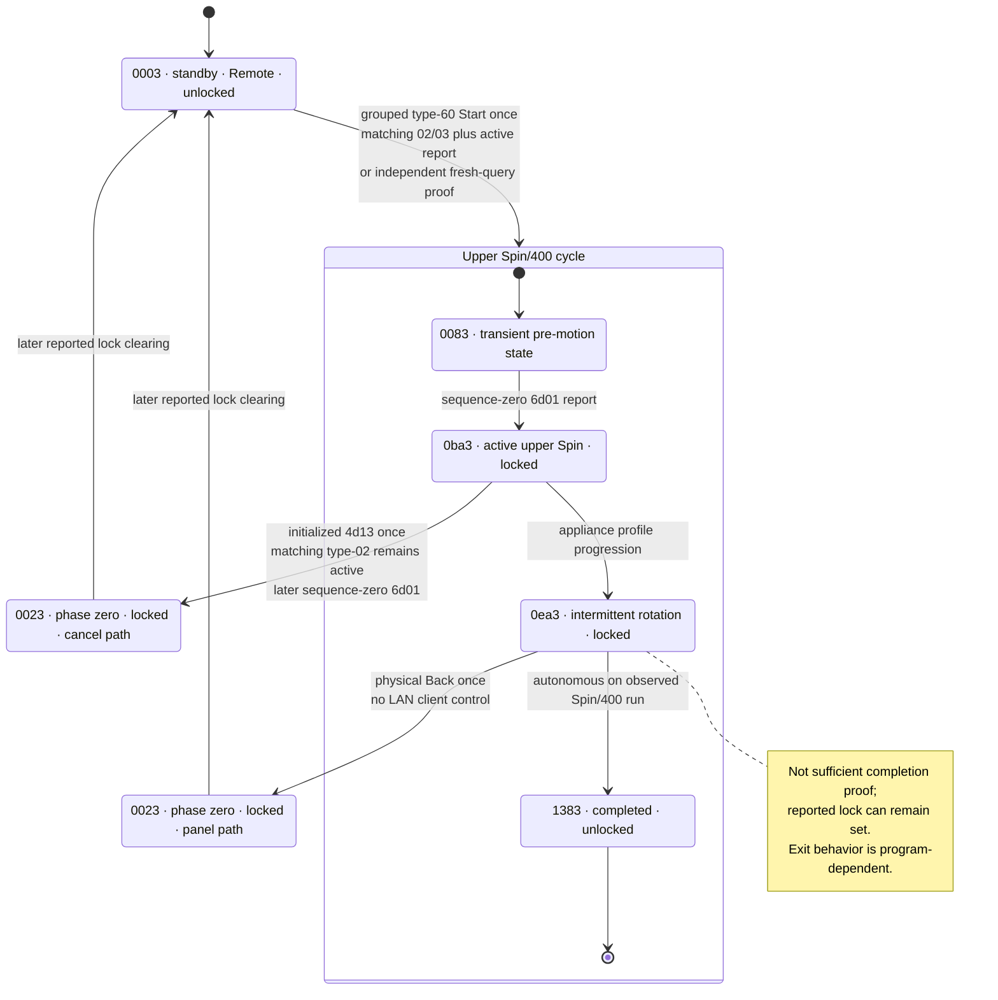

# Haier UHome Legacy UWT Protocol for HWD120-B1558U

> Copyright (c) 2026 U+ Reborn contributors. Licensed under
> [CC BY 4.0](../LICENSE). When sharing this document or adaptations, attribute
> U+ Reborn contributors, link to
> `https://github.com/Zuz666/uplus-reborn`, link to the license, and indicate
> changes.

## Status and scope

This document specifies the LAN protocol observed on one Haier
HWD120-B1558U dual-drum washer-dryer used with the Euro Haier U+ 2.6.0
application. It is an interoperability specification for this exact model and
firmware family, not a claim about every Haier, UHome, Haismart, hOn, or
SmartHQ appliance.

The observed LAN path is plaintext and does not require a Haier account, TLS,
AES or a per-device `localKey`. This document covers appliance discovery,
framing, state words and command encodings. Integration behavior and supported
user-facing features belong in [`README.md`](../../README.md); contributor
contracts belong in [`CONTRIBUTING.md`](../../CONTRIBUTING.md).

Evidence labels used below:

- **WIRE** — captured LAN bytes, with lengths and applicable checksums validated.
- **HARDWARE** — WIRE data was correlated with the appliance panel or physical
  behavior.
- **PROFILE** — the exact model profile or application metadata describes the
  field, but a one-variable hardware capture has not verified its semantics.
- **SOURCE** — inspected APK/SDK code establishes a format or behavior; target
  hardware coverage is stated separately.
- **REPORT** — decoded device state retained in client logs, without a
  synchronized complete raw packet; useful for semantics, not a byte oracle.
- **OWNER** — an owner-reported panel or physical observation; its timing and
  scope remain separate from captured bytes.
- **UNKNOWN** — bytes exist, but assigning a user-facing meaning would be a
  guess.

PROFILE does not mean hardware-validated. A writable field or source-side getter
does not establish a readable echo. Absence in bounded captures does not prove
that another firmware cannot emit a message.

### Sources and example conventions

- Euro Haier U+ **2.6.0**, uSDK **4.0.9**, APK SHA-256
  `30fd548089468cddd9b5ccce04643f9529d70016e748141d04c70f593a0ced9e`.
- Exact-target EPP format **v2**, profile **4.0.3**, server MD5
  `155461500be7ec39061387bb2ec30fd5`; model
  `device.wash.c8hu12w1org1.c` / `BaseDoubleBarrelWashData`.
- Native source anchors: `uwt_search_start` and the `0x684d` handler for discovery;
  `cae_lc_codec_uwt_2_ff55` / `decode_epp_data` for framing;
  `parse_epp_state_data` for command-specific coordinates;
  `epp_parser_attr_read` / `sdk_uwtl_attr_read` for the read-query limitation.
- The [model terminology reference](../terminology/hwd120-b1558u.md) identifies the
  user/service manuals and distinguishes their labels from APK/profile labels.

Examples marked **captured** preserve actual protocol bytes. Device identity,
opaque identifier and address slots are marked **redacted**, retaining their
widths; `00 × n` means exactly `n` zero bytes. A table marked **excerpt** omits
specified bytes and is not a complete replayable packet. Offsets are zero-based;
hexadecimal words are shown in transmitted, big-endian order. Packet diagrams
use bit offsets from the start of the stated layer, except explicitly labelled
logical bit-field views.

Complete inner frames contain no outer identifiers. Raw captures, full logs,
APKs, credentials and identifying envelope fields are not distributed here.
Source-only formats without a captured target example are explicitly identified;
no synthetic packet is presented as hardware evidence.

## Ecosystem boundary

Haier's historical [U+ announcement](https://www.haier.com/global/press-events/news/20150318_142653.shtml)
describes the broad ecosystem, but multiple incompatible LAN generations now
exist.

This appliance uses the older plaintext UWT envelope on TCP port `56800`. The
inner `FF FF` frame family agrees with the MIT-licensed
[HaierProtocol reference](https://github.com/paveldn/HaierProtocol/blob/d3334a1be24da142dd7fb68c6d2abfd628bfaded/doc/protocol_reference.rst).
HaierProtocol documents the inner frame family; it does not document this
washer's outer TCP envelope or appliance fields.

The AES/local-key uSS/HRDP protocol documented by
[Haismart Local](https://github.com/enapt/haismart-local/blob/main/PROTOCOL.md)
also uses TCP port `56800`, but it is a different transport. This washer's
captured sessions do not begin with a uSS HELLO and do not contain encrypted
application data. Port number alone is therefore not a protocol discriminator.

## Legacy LAN discovery

**WIRE + SOURCE:** the target answers legacy UDP discovery independently of
DHCP or cloud inventory. The pinned APK/uSDK establishes the request builder and
fixed legacy record layout. These are independently described wire facts, not
copied SDK implementation.

The discovery envelope is not the TCP UWT envelope:

| Offset | Bytes | Meaning |
| --- | --- | --- |
| 0 | 5 | ASCII `Haier` |
| 5 | 4 | Big-endian message ID |
| 9 | 2 | Big-endian flags |
| 11 | 6 | Unresolved header fields; zero in inspected traffic |
| 17 | 4 | Big-endian body length; total length is 21 + body length |

Request `0x6915` has a 56-byte body: a zero-filled 16-byte client identity
slot, NUL-padded `2.0.0` in eight bytes, and NUL-padded `UDISCOVERY_SDK` in
32 bytes. Send the 77-byte datagram to the interface's subnet broadcast on
UDP destination port `7083`.

Complete captured request (77 bytes). The strings occupy their full padded
slots; the client identity slot was zero, not a redacted appliance identifier.



The SDK `0x684d` handler copies a fixed 288-byte body independently of device
type. A complete datagram is 309 bytes.

Captured `684d` reply, **redacted excerpt** of a 309-byte datagram:

| Datagram bytes | Captured bytes / redaction | Meaning |
| --- | --- | --- |
| 0–4 | `4861696572` | ASCII `Haier` |
| 5–8 | `0000684d` | Legacy device record |
| 9–10 | `0000` | Not busy; security 0; not ready-to-bind |
| 11–16 | `00 × 6` | Unresolved header |
| 17–20 | `00000120` | 288-byte body |
| 21–36 | **redacted**: 12 ASCII identity bytes + `00 × 4` | Device identity |
| 37–52 | `111c1200240008100501002180008841` | First half of binary type ID |
| 53–68 | `0000d500000000000000000000000000` | Second half of binary type ID |
| 69–228 | **omitted**: 160 opaque bytes | No field semantics assigned |
| 229–244 | **redacted**: NUL-padded IPv4 text, 16 bytes | Advertised address |
| 245–308 | **omitted**: 64 opaque bytes | No field semantics assigned |

The type ID is family metadata, not a unique device identifier. It is 32 binary
bytes, not a 64-byte ASCII field.

Flags: bit 0 busy, bits 1–2 security mode, bit 3 ready-to-bind. These do not
establish physical power, Remote Control, door or cycle state. The legacy
record mapper assigns TCP port `56800`; this is not an advertised port.
Unresolved nickname/room/module buffers are not assigned invented meanings.
The separate source-defined `0x65f4` record and `0x684e` deletion messages
are not established by target hardware captures or decoded as `0x684d`.

The SDK deduplicates records by identity and expires its cache after more than
60 seconds; that is a source-side cache policy, not an appliance reply deadline.
All captured target records have security mode 0 and an advertised address
equal to the UDP sender. Discovery is unauthenticated and has no established
application checksum. Reject malformed lengths and inconsistent advertised
routing; use a separate checksum-valid TCP exchange to establish communication.

Receive on the sending socket as well as UDP/7083. Captured replies use both
the client's fixed port 7083 and its ephemeral query port; their source ports
also vary. Do not require either response endpoint to use port 7083.
Responses can arrive in duplicate bursts, and some query windows are silent.
Deduplicate by device identity; a silent window is not proof of absence.
Physical coverage is one appliance and one response payload variant, not all
firmware or security modes.

The APK also browses `_cae._udp` over mDNS. No target-origin mDNS reply was
observed in the bounded multicast/direct checks; another device's CAE service
does not establish washer mDNS support.

## Layer model



Each layer has its own length and correlation rules. A TCP read is not a frame
boundary. Implementations must buffer arbitrary fragments and may receive
multiple complete envelopes in one read.

Discovery is an optional endpoint-discovery path, not a layer inside TCP or an
inner `FF FF` message. Its unauthenticated record supplies a candidate address,
device identity and type; it does not prove control readiness. A checksum-valid
TCP exchange establishes communication, not cryptographic device authenticity.

## UWT outer envelope

All integers are unsigned and big-endian.

For the verified HWD120-B1558U, the UWT device ID is the appliance's network
MAC address written as 12 uppercase hexadecimal ASCII characters without
separators. Its identity matches the DHCP client MAC and the captured UWT
envelope; it is not a cloud token, serial number or per-device encryption key.
The address can therefore be obtained from the local router without cloud
access. This identity mapping is specific to the verified model/path, not a
claim about every Haier protocol.

### Application-data request and response: `2714` / `2715`

Decimal message IDs `10004` and `10005` are `0x00002714` and `0x00002715`.
Their fixed header is 80 bytes.

| Offset | Width | Field | Contract |
|---:|---:|---|---|
| 0 | 4 | message ID | `2714` client request; `2715` device response/publish |
| 4 | 4 | opaque word | zero in ordinary observed traffic |
| 8 | 32 | opaque identifier | client zeroes it; device may return 32 ASCII hex bytes |
| 40 | 32 | device ID | ASCII followed by NUL padding |
| 72 | 4 | sequence | request/response correlation value |
| 76 | 4 | payload length | number of bytes after the header |
| 80 | variable | payload | one complete inner frame in observed traffic |

Captured sequence-zero state-query envelope: 80-byte header plus the actual
13-byte inner request. Only the 12-byte device identity is redacted; padding
and all other fields retain their captured values.



Total envelope length is `80 + payload_length`. Bound accepted payload length
before allocation; a length field is not a TCP read boundary.

Captured `2715` response envelope, with identifying fields redacted:

| Envelope bytes | Captured value / redaction | Meaning |
| --- | --- | --- |
| 0–3 | `00002715` | Response/report family |
| 4–7 | `00000000` | Opaque word |
| 8–39 | **redacted**, 32 bytes | Opaque identifier |
| 40–71 | **redacted**: 12 ASCII identity bytes + `00 × 20` | Device identity |
| 72–75 | `00000000` | Sequence zero |
| 76–79 | `0000005d` | 93-byte inner frame |
| 80–172 | The complete captured type-`02` frame in [Captured state report](#captured-state-report) | `6d01` data; total envelope 173 bytes |

A response to an explicit request is authoritative only when both conditions
hold:

1. the outer sequence equals the request sequence; and
2. the inner payload is a valid response for that request.

Sequence-zero type-`06` reports are unsolicited events. A sequence-zero query
during initialization can also receive a valid type-`02` reply. Neither kind
can satisfy a later request allocated a nonzero sequence.

### Heartbeat: `5df2` / `5df3`

Decimal message IDs `24050` and `24051` are `0x00005df2` and `0x00005df3`.
Their fixed header is 16 bytes.

| Offset | Width | Field |
|---:|---:|---|
| 0 | 4 | message ID |
| 4 | 4 | opaque word; zero in observed traffic |
| 8 | 4 | shared request counter |
| 12 | 4 | payload length |
| 16 | variable | payload |

Captured counter-2 heartbeat pair, with only the device identity redacted.
The final 32-bit field exists only in the accepted `5df3` response;
the `5df2` request ends after the padded device ID.



A client `5df2` payload is 48 bytes: 32 zero bytes followed by the ASCII device
ID padded to 16 bytes. An accepted `5df3` repeats those 48 bytes and appends a
four-byte device status, producing a 52-byte payload and 68-byte envelope.

Application-data requests and heartbeats share one monotonically increasing 32-bit
counter in an initialized session. Observed sessions use an approximately
five-second heartbeat interval.

A captured session completed `4d01` and `73`/`74` initialization but received
`5def`, not `5df3`, for its first counter-2 heartbeat. The payload ends in
`00005df2`, identifying the rejected request family. Identical heartbeat bytes
are accepted in other active and idle sessions. The cause and exact `5def`
semantics remain UNKNOWN; neither a connection overlap nor a cooldown is a
verified rule. Successful initialization alone does not establish persistent
session liveness. Serialized short reads have been observed to work after
control; persistent overlapping/reconnected sessions are not established.

Complete captured `5def` envelope, 52 bytes, with no device identity:

| Bytes | Captured value | Established interpretation |
| --- | --- | --- |
| 0–3 | `00005def` | Unclassified/rejection-shaped response |
| 4–7 | `00000000` | Opaque word |
| 8–11 | `00000002` | Counter 2 |
| 12–15 | `00000024` | 36-byte payload |
| 16–47 | `00 × 32` | Zero prefix |
| 48–51 | `00005df2` | Heartbeat request ID; not a successful `5df3` |

## Inner `FF FF` frame

The logical frame before byte stuffing is:

```text
FF FF | L | flags | reserved[5] | frame_type | payload | checksum [| CRC16]
```

| Field | Width | Contract |
|---|---:|---|
| separators | 2 | literal `FF FF`; not included in `L` or checksum |
| `L` | 1 | `8 + payload_length`; allowed range `8..0xF1` |
| flags | 1 | zero in this model's observed frames |
| reserved | 5 | zero in generated and observed ordinary frames |
| frame type | 1 | transaction kind |
| payload | `L - 8` | EPP command and data |
| checksum | 1 | low byte of the encoded body sum |
| optional CRC16 | 2 | indicated by flag `0x40`; not observed or accepted here |

The [complete inner-frame examples](#sanitized-complete-inner-frame-examples)
show actual offsets and values for fixed-size requests. Variable payloads and
byte stuffing change subsequent physical offsets; a checksum has no universal
fixed offset.

### Byte stuffing and checksum

After the two separators, logical `FF` bytes in the length, header and payload
are encoded as `FF 55`. The checksum is the low eight bits of the sum of encoded
bytes from `L` through the end of the payload. Equivalently, sum the de-stuffed
logical body bytes and add `0x55` for each stuffed logical `FF`.

The APK-derived client encoder also encodes checksum `FF` as `FF 55`.
Device responses additionally use a **single terminal `FF` checksum**: twelve
complete captured responses independently validate this representation.
The decoder accepts either form at the checksum boundary only; a literal
checksum must be the final byte of the complete inner frame. Body escaping,
declared length, checksum equality and trailing-byte rejection remain strict.
CRC-bearing frames remain unsupported.

The [captured type-`06` state example](#captured-state-report) is 93 bytes:
checksum byte 92 is literal `ff`, and the sum of encoded bytes 2–91 modulo
256 is `ff`. There is no byte 93. This is distinct from the SOURCE-defined
outbound representation, which would append `55` after that checksum.
The additive checksum detects corruption; it is not authentication.

No stuffed body byte was found in the inspected captures. Body stuffing and
outbound checksum escaping are SOURCE, not observed target-body behavior.

### Observed frame types

| Type | Role | Evidence |
|---:|---|---|
| `01` | direct control/query | WIRE |
| `02` | correlated status | WIRE |
| `03` | grouped response/ACK | WIRE in some grouped Start sessions; not guaranteed; payload semantics unresolved |
| `04` | alarm/status family | WIRE; payload semantics incomplete |
| `05` | empty response, semantics unclassified | WIRE; matching grouped Start sequence, not accepted as ACK |
| `06` | unsolicited state report | WIRE |
| `60` | grouped profile write | WIRE for upper and lower Spin Start |
| `72` | empty unsolicited frame | WIRE; semantics unresolved |
| `73` | empty initialization/alarm query | WIRE |
| `74` | matching initialization response | WIRE; captured response carries alarm/status bytes |

The captured empty type `05` frame is checksum-valid, not a corrupt type `03`.
It can precede an unsolicited active report without a matching `02`/`03`.
These are distinct complete captured examples, with no outer identifiers:

| Type | Complete inner frame | Interpretation limit |
| --- | --- | --- |
| `03` | `ffff0c000000000000030000000413` | Four-byte payload `00000004`, checksum `13`; not an empty ACK |
| `04` | `ffff18000000000000040f5a000000000000000000000000000085` | 16-byte alarm/status payload; no decoded alarm meaning claimed |
| `05` | `ffff08000000000000050d` | No payload; checksum `0d`; not proof of command success |
| `72` | `ffff08000000000000727a` | No payload; checksum `7a`; not a `6d01` state report |

Types `01`/`60` appear below, `73`/`74` in the
[initialized session](#initialized-control-session), and complete `02`/`06`
reports in the [`6d01` example](#captured-state-report).

### Sanitized complete inner-frame examples

Captured state-query inner frame, 13 bytes:



Captured upper Spin/400 Start: a complete 35-byte type-`60` frame carrying all
12 profile words. Its fields are described under
[Upper grouped write](#upper-grouped-write-0001).



## Session and transaction model

### Short read

The proven read-only transaction is:

1. open TCP;
2. allocate sequence `0`;
3. send `2714` carrying frame type `01`, payload `4d01`;
4. accept the first checksum-valid `6d01` type `02` or type `06` whose outer
   sequence is `0`;
5. close TCP without retry.

A client may receive other valid sequence-zero reports while waiting for a
later non-zero query. Process incoming envelopes in arrival order, including
unmatched state reports, without promoting them to a correlated query reply.
Control initialization immediately checks each observed state before dispatch;
confirmation immediately applies each report to its existing proof channels,
with later observations superseding earlier tentative evidence. The incoming
stream queue preserves unprocessed envelopes, not a history of consumed reports.
Optional passive exchange observation can expose that processing chronology;
consumed reports need not remain in a separate decoded-state backlog.

The captured `2714` query and `2715` reply above illustrate this exchange:
sequence `00000000`, request length `0000000d`, reply length `0000005d`.
The reply's type-`02` inner frame is reproduced in
[Captured state report](#captured-state-report).

### Initialized control session

The original U+ client and the independently verified local implementation use:

1. sequence `0`: `4d01` and a matching `6d01`;
2. sequence `1`: empty type `73` and a matching type `74`;
3. sequence `2` and later: control or heartbeat on the same shared counter.

The query is empty, but the captured response is not. This complete pair uses
outer sequence `1` in both directions:

| Direction | Type | Complete captured inner frame |
| --- | --- | --- |
| Client → appliance | `73` | `ffff08000000000000737b` |
| Appliance → client | `74` | `ffff18000000000000740f5a0000000000000000000000000000f5` |

The response has logical length `18` hex (24), 16 payload bytes
`0f5a` followed by 14 zeros, and checksum `f5`. Type `04` above carries the same
payload in an unsolicited frame. The profile identifies alarm query attribute
`2000ZY`; the payload's individual alarm meanings are not established here.

Controls are serialized and dispatched exactly once. A matching type `02` or
`03` response is followed by an independent fresh postcondition report.
Unclassified raw `05` is never relabelled an ACK: a separate `4d01`, using a
fresh allocated sequence, may instead establish the requested state. If an
early query precedes the transition, further serialized state queries continue
at the existing confirmation interval within the original command deadline,
without depending on another unsolicited report. A candidate report alone is
not proof: a query reply must match its allocated sequence and independently
satisfy the postcondition. This neither resends the control nor accepts an
unrelated queued report as a query reply.
Only one state query is outstanding at a time. A matching control acknowledgement
and independent postcondition report can still resolve the control while that
query awaits its reply.

If confirmation is absent, or TCP fails after dispatch, the outcome is unknown,
not necessarily a failed write. A later read can establish current state without
retrospectively proving the earlier operation.

## EPP field coordinates

The model profile describes fields as:

```text
[label]^attribute#kind&value_map@write_metadata#response,word,bit,width$
```

For this profile:

- `word` is a 16-bit word index relative to the EPP command word;
- words are big-endian;
- bit zero is the least-significant bit;
- widths may span adjacent words;
- in the unstuffed inner frame, word `n` starts at byte `10 + 2*n`; stuffing
  changes physical wire offsets, not logical coordinates;
- `!` means the profile has no direct coordinate;
- grouped definitions pack many attributes into one write.

For a concrete extraction, the captured type-`06` report below has word 26
`05a1` at inner bytes 62–63: phase is `05`, cycle-active bit 7 is set, and
reported-lock bit 5 is set. Its word 33 is `1e00` at bytes 76–77: target
temperature is `0x1e` = 30°C, wash-stage value is zero. Coordinates refer to
the command payload, not the 80-byte outer envelope.

## `6d01` state block

A normal state payload begins with command word `6d01` and contains at least 41
big-endian words (82 bytes). The captured target uses words `0..40`.

The table is deliberately exhaustive at the block level. Exact-profile setting
definitions establish field coordinates without claiming independent physical
validation. Unmapped or semantically ambiguous coordinates are not interpreted
as active state; a writable field is not proof of a readable echo.

The following packet diagram uses logical EPP bit coordinates, numbered from
the least-significant bit. The 16-bit word itself is transmitted big-endian,
so this is a field-coordinate view rather than byte order on the wire.



| Word(s) | Bits | Attribute | Meaning | Evidence |
|---:|---:|---|---|---|
| 0 | 0..15 | — | command `6d01` | WIRE |
| 1 | 8..15 | `20500N` | upper selected program | WIRE; `0x1c` = Spin |
| 2 | 2 | `20501a` | upper delayed/reserved flag | PROFILE |
| 2 | 3 | `205005/6` | child/control lock setting | PROFILE/REPORT; reported-flag round trip, not physical panel-lockout proof |
| 2 | 8 | `20500l/m` | inverted buzzer-setting flag | PROFILE/REPORT; reported-flag round trip, not acoustic proof |
| 2 | 9 | `20501A` | upper smart-wash flag | PROFILE |
| 2 | 14 | `20500L/M` | water-reuse flag | PROFILE; conflicting app branch is not independent verification |
| 3 | 0 | `60500P` | appliance power | HARDWARE |
| 3 | 1 | `60500V` | physical Remote Control mode | HARDWARE |
| 3 | 2 | `6050ZV` | vendor force-delete flag | PROFILE |
| 3 | 3 | `60500Q` | local control lock | PROFILE |
| 3 | 5 | `605003` | upper reported door-lock flag | HARDWARE; not physical position or guaranteed latch state |
| 3 | 6 | `605004` | upper raw activity flag | UNKNOWN; remained zero during proven motion |
| 3 | 7 | `205003/4` | upper cycle-active / Start-Pause state | PROFILE/WIRE/REPORT; pause-resume correlation, not motor motion |
| 3 | 8..15 | `605002` | upper program phase | PROFILE with target observations detailed under Program phases |
| 4 | 0..7 | `605008` | upper remaining hours | WIRE; applicable only outside phase zero |
| 4 | 8 | `605005` | upper raw door field | HARDWARE rejects physical-position interpretation; opening the door did not change it |
| 4 | 9..12 | `20500q/p/n/s` | upper completion-related flags | PROFILE |
| 4 | 13 | `2000ZC` | production-test flag | PROFILE |
| 4 | 14..15 | `605006/7` | upper rinse decrement/increment flags | PROFILE |
| 5 | 0..7 | `60500a` | upper raw hint code | PROFILE; semantics unresolved |
| 5 | 8..15 | `605009` | upper remaining minutes | WIRE; not a countdown in phase zero |
| 6 | 0..15 | `60500R` | upper cycle ordinal | PROFILE |
| 7 | 0..15 | `60500b` | upper cumulative cycle count | WIRE; scale is integer cycles |
| 8 | 0..15 | `60500c` | current/session water, unsigned 16-bit, reported L | PROFILE/WIRE; unit APK/OWNER |
| 9..10 | 0..31 | `60500d` | cumulative water, unsigned 32-bit, high word first, reported L | PROFILE/WIRE; unit OWNER |
| 11 | 0..15 | `60500e` | current/session energy, unsigned 16-bit, reported kWh | PROFILE/WIRE; unit APK/OWNER |
| 12..13 | 0..31 | `60500f` | cumulative electricity, unsigned 32-bit, high word first, reported kWh | PROFILE/WIRE; unit OWNER |
| 14 | 0..7 | `20500S` | upper reported rinse count | PROFILE/WIRE/REPORT; seven observed at panel Start; subsequent wash reports decrement |
| 15 | 0..7 | `20500U` | upper reported spin-stage time | PROFILE/WIRE; not selected RPM or a guaranteed immutable duration |
| 15 | 8..15 | `20500P` | upper configured clothing weight | PROFILE |
| 16 | 0..7 | `20500R` | upper reported wash-stage time | PROFILE/WIRE; includes applicable heating, not the original manual main-wash setting |
| 16 | 8..15 | `20500Q` | upper reported program temperature | PROFILE/WIRE; whole degrees, not measured water temperature |
| 17 | 0,1,2,3,5,6 | `20501b..g` | high-water, Easy Iron, super-clean, energy-save, soak, night flags | PROFILE; Easy Iron bit 1 stayed WIRE zero through the full Spin lifecycle |
| 18 | 8..15 | `20501h` | upper retained stain code | WIRE for Blood/Wine; ordinary mapping below, no proven active-stain flag; low byte remains UNKNOWN |
| 19 | 0..15 | `20500V` | source-declared upper spin-speed field | PROFILE only as selected-speed readback; zero in nonzero-speed references; do not confuse it with group word 5 |
| 20 | 0..7 | `60500q` | upper softener raw value | PROFILE |
| 20 | 8..15 | `60500r` | upper detergent raw value | PROFILE |
| 21 | 0..7 | `60500T` | upper measured clothing weight | PROFILE |
| 21 | 8..15 | `20501s` | upper wash rotation speed | PROFILE |
| 22 | 0..7 | `20501u` | upper wash stop time | PROFILE |
| 22 | 8..15 | `20501t` | upper wash rotation time | PROFILE |
| 23 | 0..15 | `20501v` | upper wash water level | PROFILE |
| 24 | 0..7 | `205018` | lower drying procedure | PROFILE |
| 24 | 8..15 | `20500Y` | lower selected program | WIRE; `0x1c` = Spin and `0x1f` = Bedding observed |
| 25 | 2 | `20501i` | lower delayed/reserved flag | PROFILE |
| 25 | 9 | `20501B` | lower smart-wash flag | PROFILE |
| 26 | 5 | `60500u` | lower reported door-lock flag | HARDWARE in Remote-Control standby and captured lower active/completed paths; not physical position |
| 26 | 6 | `60500v` | lower raw activity flag | UNKNOWN |
| 26 | 7 | `20500u/v` | lower cycle-active / Start-Pause state | PROFILE/REPORT; panel pause-resume correlation, not motor motion |
| 26 | 8..15 | `60500t` | lower program phase | PROFILE with target observations detailed under Program phases |
| 27 | 0..7 | `60500z` | lower remaining hours | WIRE; applicable only outside phase zero |
| 27 | 8 | `60500w` | lower raw door field | UNKNOWN; not proof of physical position |
| 27 | 9..12 | `20500J/I/H/K` | lower completion-related flags | PROFILE |
| 27 | 14..15 | `60500x/y` | lower rinse decrement/increment flags | PROFILE |
| 28 | 0..7 | `60500B` | lower raw hint code | PROFILE; semantics unresolved |
| 28 | 8..15 | `60500A` | lower remaining minutes | WIRE; not a countdown in phase zero |
| 29 | 0..15 | `60500S` | lower cycle ordinal | PROFILE |
| 30 | 0..15 | `60500C` | lower cumulative cycle count | WIRE; scale is integer cycles |
| 31 | 0..7 | `205013` | lower reported rinse count | PROFILE/WIRE/REPORT; eight observed in panel-started Mix; subsequent wash reports decrement |
| 32 | 0..7 | `205015` | lower reported spin-stage time | PROFILE/WIRE; decreased during Spin, not selected RPM |
| 32 | 8..15 | `205010` | lower configured clothing weight | PROFILE |
| 33 | 0..7 | `205012` | lower reported wash-stage time | PROFILE/WIRE; decreases during washing and includes applicable heating |
| 33 | 8..15 | `205011` | lower reported program temperature | PROFILE/WIRE; whole degrees, independent of the stain-code field |
| 34 | 0,1,2,3,5,6 | `20501j..o` | lower high-water, Easy Iron, super-clean, energy-save, soak, night flags | PROFILE |
| 35 | 8..15 | `20501p` | lower retained stain code | WIRE; six ordinary choices mapped below, may persist after panel clearing |
| 36 | 0..15 | `205016` | source-declared lower spin-speed field | PROFILE only as selected-speed readback; zero in nonzero-speed references |
| 37 | 0..7 | `60500N` | lower softener raw value | PROFILE |
| 37 | 8..15 | `60500O` | lower detergent raw value | PROFILE |
| 38 | 0..7 | `60500U` | lower measured clothing weight | PROFILE |
| 38 | 8..15 | `20501w` | lower wash rotation speed | PROFILE |
| 39 | 0..7 | `20501y` | lower wash stop time | PROFILE |
| 39 | 8..15 | `20501x` | lower wash rotation time | PROFILE |
| 40 | 0..15 | `20501z` | lower wash water level | PROFILE |

### Captured state report

Two independent complete 93-byte inner frames are shown side by side. Read each
column top to bottom, removing spaces between words. Neither column contains
redactions or invented padding. The left frame is a query reply showing upper
Completed/lower Standby; the right is an unsolicited lower Bedding report.

| Inner bytes | Field / EPP words | Captured type `02` | Captured type `06` |
| --- | --- | --- | --- |
| 0–9 | Marker, length `5a`, flags/reserved, type | `ffff5a00000000000002` | `ffff5a00000000000006` |
| 10–19 | 0–4 | `6d01 1c00 0000 1383 0100` | `6d01 1c00 0000 0001 0100` |
| 20–29 | 5–9 | `0000 0000 016f 0006 0000` | `0600 0000 0171 0003 0000` |
| 30–39 | 10–14 | `f850 0000 0001 262d 0000` | `f865 0000 0001 2631 0000` |
| 40–49 | 15–19 | `0000 0000 0000 000e 0000` | `0002 0000 0000 000e 0000` |
| 50–59 | 20–24 | `0000 0000 0000 0000 0000` | `0000 0000 0000 0000 1f00` |
| 60–69 | 25–29 | `0000 0021 0100 0200 0000` | `0000 05a1 0101 2700 0000` |
| 70–79 | 30–34 | `01be 0000 0000 0000 0000` | `01be 0006 0002 1e00 0000` |
| 80–89 | 35–39 | `0000 0000 0000 0000 0000` | `0000 0000 0000 0000 0000` |
| 90–91 | 40 | `0000` | `0000` |
| 92 | Checksum | `80` | `ff` (literal terminal byte) |

Both have outer sequence zero in their respective captures. Frame type and
request context distinguish an initial query reply from an unsolicited report;
the shared sequence value alone does not.

### Reported cycle-setting fields

Reported `6d01` cycle-setting words reflect the currently active or reserved
cycle on the appliance, regardless of whether it was started from the physical
panel, legacy app, or LAN client. A source default determines field
applicability for the active program only; it is never substituted for a
reported wire value.

Ordinary Standby, Completed, unknown program/phase, and missing settings carry
no active setting echo. Reported pending Start/reservation flags can establish
cycle context during a phase-zero transition, while paused and
intermittent-rotation cycles retain applicable reported values. Fixed program
settings remain readable in `6d01` even when the source UI does not allow
editing them before Start.

Temperature is the effective program target, not measured water temperature;
zero denotes unheated operation. Stage counters include applicable heating and
can decrease during execution; they cannot reconstruct original main-wash
minutes or selected RPM. The numeric delay mapping, useful selected-speed echo,
active-stain flag, and exact Smart fabric/stain identity remain unresolved.
Neither retained stain codes nor recipe arithmetic can fill those gaps.

Captured field excerpts illustrate the distinction between command and report:

| Packet / coordinate | Actual bytes | Interpretation |
| --- | --- | --- |
| Upper Spin Start, group word 5 | `0190` | Commanded 400 RPM |
| Active upper Spin `6d01`, words 1 / 3 / 19 | `1c00` / `0ba3` / `0000` | Spin and active phase confirmed; no selected-speed echo |
| Lower Bedding type `06` above, words 31 / 32 / 33 | `0006` / `0002` / `1e00` | Rinse value 6, spin-stage value 2, target 30°C and wash-stage value 0 |

Nonzero 600/1000/1200 RPM upper commands also have captured Spinning-phase
reports with word 19 zero. Zero is not thereby established as a universal
missing-value sentinel or a physical speed measurement. Numeric delay properties
have zero-width report coordinates; reservation bits and the ordinary countdown
cannot be substituted for an immutable copy of configured delay.

The reported rinse coordinate can also decrease during a cycle: owner-operated
upper Casual and lower Mix washes produced successive counts from seven down to
one. It is not an immutable echo of the originally selected total. Exact
decrement boundaries remain unresolved; do not relabel it as a precisely
defined remaining-rinse counter.

### Execution state versus program phase

Decoded phase and cycle/reservation flags in `6d01` determine per-drum
execution state according to the following precedence:

| Report context | Execution state |
| --- | --- |
| Unsupported phase | Unknown |
| Completed or drying-finished phase, regardless of activity | Completed |
| Standby or delayed-start phase with reservation flag | Delayed |
| Standby without reservation or cycle activity | Standby |
| Active Standby without reservation, or delayed-start without reservation | Unknown |
| Other known operational phase with cycle activity | Running |
| Other known operational phase without cycle activity | Paused |
| No current authoritative report | Unknown; no flag or phase can be inferred |

Pausing retains the phase: observed panel Pause/Resume at phase `0x09` changes
execution Spinning/Running → Spinning/Paused → Spinning/Running, independently
for each drum. Intermittent rotation is still its own phase, not Completed.
This is contextual source-backed interpretation of `6d01` flags, not new
physical phase evidence or a direct motor-motion measurement.

### Consumption accounting contract

**PROFILE/APK:** The exact HWD120-B1558U profile (version 4.0.3 in U+ 2.6.0)
defines `60500c` through `60500f` with the identity `#1&1,0` transform.
Current water and electricity are unsigned 16-bit values at words 8 and 11;
cumulative water and electricity are unsigned 32-bit values at words 9–10
and 12–13, high word first. These are separate from the upper/lower cycle
counters (`60500b`, word 7; `60500C`, word 30). Target-model getters/setters
assign directly, and both drum view models receive the same four getters.
Their location among upper fields and their presentation in both views do not
establish upper-only ownership or independent per-drum counters.

The complete lower Bedding type-`06` example above decodes as:

| EPP words | Captured bytes | Raw reported value |
| --- | --- | --- |
| 8 | `0003` | Current/session water: 3 L |
| 9–10 | `0000 f865` | Cumulative water: 63,589 L |
| 11 | `0000` | Current/session electricity: 0 kWh |
| 12–13 | `0001 2631` | Cumulative electricity: 75,313 kWh |

These are literal appliance-reported numbers, not independently calibrated
metering or a claim that the values are physically plausible.

**APK/WIRE/OWNER:** Target current-counter finish presenters stringify the
getter values without scaling. A synchronized naturally completed upper
Spin/400 run correlated current raw water `2` with U+ `2 Liter` and raw
electricity `1` with `1.0 kWh`. Cumulative L/kWh units are owner-confirmed.
An exact-target cumulative presenter and exact numeric cumulative-screen
correlation were not recovered; a single-drum presenter from another device
family is not evidence for this target. No `/10`, `/1000`, or Wh reinterpretation
is supported by the recovered target sources.

**Bounded observations, not universal accounting rules:**

| Observed path | Current fields | Cumulative fields and timing |
| --- | --- | --- |
| Lower Bedding natural completion | Water/energy stayed `3`/`0` | Raw `+62`/`+25` at lower completion |
| Lower Spin followed by owner-confirmed Stop | Water/energy `0`/`0` → `2`/`1` | Water `+2`, energy unchanged; lower cycle count unchanged |
| One empty upper Spin/400 natural completion | Raw water/energy `+3`/`+1` during `0x0e` | Same raw deltas during `0x0e`, one minute remaining, before `0x13` |
| Another upper Spin/400 natural completion | No complete per-cycle coverage inferred | Water committed during `0x0e`, one minute remaining; energy unchanged through `0x13` and reported unlock |
| Concurrent upper Quick wash and lower timed Dry | Raw water/energy `19`/`0` → `33`/`29` at first upper `0e`; unchanged at first lower `0e` | Water `+14` at upper `0e`, then water/energy `+4`/`+30` at lower `0e`; both cycle counts still unchanged |

The stopped lower Spin returned to U+ Standby without an End-consumption
presenter. These observations establish neither complete whole-appliance
coverage nor a universal per-cycle, upper-only, commit-at-zero, or
commit-at-`Completed` rule. The owner observed accumulation between programs,
session reset on panel power-off, and possible loss of pending cumulative
updates on that path. Persistence across mains loss is unknown.

### Remaining-time invariant

The appliance retains non-display values in the raw time words while a drum is
in phase zero. Therefore:

```text
remaining_minutes = hours * 60 + minutes, only when phase != 0
remaining_minutes = absent, when phase == 0
```

Publishing the retained raw value in standby creates a false countdown.

The complete type-`02` example above has lower phase/flags `0021`, hour word
`0100` and minute word `0200`. The low hour byte is zero and the high minute
byte is two, but phase zero means **no countdown**, not “two minutes remaining.”
By contrast, the type-`06` lower Bedding example has `05a1`, `0101`, `2700`:
phase `05`, one hour and `0x27` = 39 minutes, yielding 99 remaining minutes.

### Extended `7d01` / `7d02` fields

The profile declares the following eleven alternate-report fields. There is
**no captured target `7d01`/`7d02` packet example** and no established request
that retrieves them. All rows remain PROFILE:

| Response | Word(s), bits | Attribute | Meaning |
|---|---|---|---|
| `7d01` | 8, 0..15 | `7050a0` | upper current water raw value |
| `7d01` | 3, 1 | `70500V` | physical Remote Control flag |
| `7d01` | 5, 0..7 | `70500a` | upper hint code |
| `7d01` | 9..10, 0..31 | `7050a1` | upper cumulative water raw value |
| `7d01` | 11, 0..15 | `7050a2` | upper current electricity raw value |
| `7d01` | 12..13, 0..31 | `7050a3` | upper cumulative electricity raw value |
| `7d01` | 16, 8..15 | `70500Q` | upper configured wash temperature |
| `7d01` | 25, 8..15 | `7050a4` | upper measured wash temperature |
| `7d02` | 5, 0..7 | `70500B` | lower hint code |
| `7d02` | 10, 8..15 | `705011` | lower configured wash temperature |
| `7d02` | 19, 8..15 | `7050a5` | lower measured wash temperature |

All eleven declarations have outbound metadata `@!&!,!`: receive coordinates,
not executable queries. Native `parse_epp_state_data` matches the response
command before extracting a field. Never apply these offsets to `6d01`.
The SDK also has a receive-side type-`66` / `7d` big-data branch; that does not
prove target emission or an outbound query.

In the inspected SDK, `epp_parser_attr_read` returns `-8` and
`sdk_uwtl_attr_read` returns `-23010` without transport dispatch. The known
target status operation remains `2000ZZ` → `4d01` → `6d01`.
The source's `5d04`/`5d84` delay and `5d19`/`5d99` speed commands are
**setters**, not alternative read requests. No example of those setters or the
alternate report family is claimed as captured hardware behavior.

## Program values

The profile encodes a program value as an index and represents it textually as
`30500` plus a base-62-like alphabet character. It defines 12 upper and 20 lower
programs. Labels below are APK/profile names, not the integration's naming
register. Captured Spin commands and representative programme reports supplement
the source; they do not validate every programme or option combination.

Captured examples locate the enum in context: the upper Spin Start diagram has
group word 1 `1c00`; the lower Bedding state example has report word 24 `1f00`.
The high byte carries the programme. The low bytes have different meanings in
the two layouts; do not copy a report word directly into a grouped command.

### Upper drum

| Value | Code | Label | Evidence |
|---:|---|---|---|
| `0x07` | `305007` | Kids' Wear | PROFILE |
| `0x09` | `305009` | Allergy Care | PROFILE |
| `0x0d` | `30500d` | Drum Clean | PROFILE |
| `0x0e` | `30500e` | Underwear | PROFILE |
| `0x0f` | `30500f` | Quick Wash | PROFILE/REPORT |
| `0x13` | `30500j` | Delicate Care | PROFILE |
| `0x14` | `30500k` | Baby Care | PROFILE |
| `0x15` | `30500l` | Casual | PROFILE/REPORT |
| `0x18` | `30500o` | Colored Laundry | PROFILE |
| `0x1a` | `30500q` | Towels | PROFILE |
| `0x1b` | `30500r` | Rinse+Spin | PROFILE |
| `0x1c` | `30500s` | Spin | WIRE/HARDWARE |

### Lower drum

| Value | Code | Label |
|---:|---|---|
| `0x01` | `305001` | Cotton |
| `0x02` | `305002` | Synthetic |
| `0x03` | `305003` | Down |
| `0x04` | `305004` | Curtain |
| `0x05` | `305005` | Mix |
| `0x06` | `305006` | Shirts |
| `0x09` | `305009` | Hygiene |
| `0x0a` | `30500a` | Wool |
| `0x0b` | `30500b` | Jeans |
| `0x0c` | `30500c` | Refresh |
| `0x0d` | `30500d` | Drum Clean |
| `0x0f` | `30500f` | Quick Wash |
| `0x11` | `30500h` | Bulky |
| `0x12` | `30500i` | Sports Wear |
| `0x13` | `30500j` | Delicate Care |
| `0x1b` | `30500r` | Rinse+Spin |
| `0x1c` | `30500s` | Spin |
| `0x1d` | `30500t` | Dry |
| `0x1f` | `30500v` | Bedding |
| `0x20` | `30500w` | Outdoor Care |

Lower Spin `0x1c` and Bedding `0x1f` have WIRE/HARDWARE state observations.
Lower Spin/400 also has captured grouped Start and `4d93` Cancel commands.
Mix, Rinse+Spin, smart Delicate Care and Dry have REPORT evidence.
A state observation alone is not a captured control command.

The exact profile defines per-program defaults and allowed main-wash duration,
temperature, rinse count and spin speed. Grouped builders add temperature-dependent
heating and program/option time adjustments; UI minutes are not necessarily the
wire duration. A singleton source list is a fixed setting, not an adjustable
range. For example, Tub Clean has fixed 90°C and 600 RPM; Night wash is its only
optional function in the target manual/source. These are source-defined command
constraints, not new packet captures.

The lower drying byte has six source-defined coordinates: off `0`/`305000`,
auto `10`/`30500a`, and 30/60/90/120 minutes as values `7/6/5/4` and codes
`305007/6/5/4`. U+'s per-program map further removes off for Dry and removes
every mode except 30 minutes for Refresh; programs whose drying function is
excluded expose none.

The raw delay coordinate space is `0..48` half-hour steps, but this is not the
UI choice list. For each delay-capable program U+ adds off `0`, then whole-hour
end times from `ceil(source cycle minutes / 60)` through 24 hours. Programs
whose delay function is excluded expose no delay choice. Complete physical delay
and drying behavior is not established by the source-defined choices alone.

Group word 7 exposes six APK booleans per drum: high water, Easy Iron,
intensive/super-clean, eco, soak, and night. APK UI maps provide exact
per-program inclusion/exclusion lists for those functions, plus delay and
lower-drum drying. This proves individual source-side availability only, not
that two offered options are compatible together or accepted in a grouped write.

The smart-wash path offers 19 upper and 24 lower fabric IDs and 30 named
`W1..W30` stain rows. It derives an ordinary program, applies the source
priority ordering to selected stains and then the material's source limits.
The source stain object's `level` is a recipe priority, not an ordinary stain
wire enum. Smart mode does not independently maximize every selected row.
Its presenter disables manual scalar and extra-option edits. The selected
fabric and W-row identities are not separate fields in the 24-byte grouped
command. Different source selections can produce identical complete commands:
upper A1/A2 and lower A3/A4 are concrete no-stain collisions. Thus effective
programme/scalar readback cannot uniquely reconstruct those identities; a
separate identity-bearing message would need independent evidence.

The HWD120-B1558U owner's manual, printed pages 18–19 and §7.10.2 on page 29,
also documents six ordinary stain choices for upper Kids wear/Casual and lower
Cotton/Mix/Synthetic, independently of Smart fabric:

| Ordinary stain | Wire code | Recipe temperature, °C | Wash-stage construction |
| --- | ---: | --- | --- |
| Blood | 1 | 60 | 9 minutes plus exact-program source heating |
| Grass | 2 | 60 | 10 minutes plus exact-program source heating |
| Wine | 3 | Lower 50; upper 55 | Lower 25; upper 35 minutes, observed complete stage totals |
| Juice | 7 | 30 | 10 minutes plus exact-program source heating |
| Soil | 5 | 60 | 40 minutes plus exact-program source heating |
| Milk | 6 | 30 | 40 minutes plus exact-program source heating |

Hardware references cover all six lower Mix choices and upper Casual Blood/Wine.
Lower Blood reported 49 minutes, matching 9 + 40; upper Casual reported 39,
matching 9 + 30.
Wine does not follow the corresponding Smart-row arithmetic, so its paired
per-drum observed totals are used instead. Other supported program combinations
remain source-derived/reference-transfer coverage, not full native-panel parity.
Compatible Intensive adds the existing source time allowance.

Ordinary stains own temperature and complete wash-stage time. There is no
invented reverse mapping to an original user-selected main-wash duration.
Selecting an ordinary stain excludes Eco/Night/Soak and manual temperature or
main-wash overrides; clearing the stain restores program temperature and
main-wash defaults.

A panel no-stain Mix run retained the previous Blood code. Separate grouped
Starts verified explicit clearing to zero and changing zero to Wine while
independently supplied temperature/time remained unchanged. Thus a retained
code is not proof of active stain removal, and changing the enum alone does
not reproduce the panel recipe. A grouped command must carry both the ordinary
code and effective temperature/time; a neutral ordinary selection uses explicit
zero rather than inheriting a retained tag. Smart W-row IDs are not ordinary
wire codes. Neutral clearing was physically checked on lower Mix; other
combinations are not established by that one observation.

Refresh is a source quirk: its UI offers only 30-minute drying, but its command
builder skips the drying setter and preserves the reported byte. The displayed
choice is not evidence that the write contains drying value `7`, nor that the
selected duration can be independently confirmed from that command.

## Program phases

The profile supplies generic labels for all phase codes. Hardware evidence is
narrower and takes precedence for this target.

| Value | Profile label | Target interpretation | Evidence |
|---:|---|---|---|
| `00` | Standby | standby / non-active | HARDWARE |
| `01` | Weighing | observed at upper Casual/Eco Start; not an independent load measurement | REPORT |
| `02..06` | Washing substeps | `05` during lower Bedding, upper Quick wash, lower smart wash and initial timed Dry | WIRE/HARDWARE for `05`; labels are not program-exclusive |
| `07..0a` | Spinning substeps | lower `09` during Bedding and Rinse + Spin | WIRE/HARDWARE for `09`; other values PROFILE |
| `0b` | Spinning | active locked Spinning for upper Spin, lower Bedding, and lower Spin | HARDWARE |
| `0c` | Drying | observed during lower timed Dry/30 after initial phase `05` | REPORT; heater operation not independently measured |
| `0d` | Cooling | unverified | PROFILE |
| `0e` | End washing | `intermittent_rotation`; not sufficient wire-completion proof; exit is program-dependent | HARDWARE |
| `0f` | Time-delay running | upper delayed Quick wash, reservation active, 60 reported minutes for selected one-hour finish delay | REPORT; not a universal exact-delay echo |
| `10` | Intermittent tumbling | intermittent rotation; observed in both drums during washes with Easy Iron enabled | REPORT/OWNER; interrupted by the owner, not autonomous-completion proof |
| `11` | Drying | unverified | PROFILE |
| `12` | Drying finished | unverified | PROFILE |
| `13` | Intermittent tumbling finished | completed phase; observed for upper Spin/Quick wash and lower Bedding; lock and cycle-active flags may remain set | WIRE/HARDWARE; not a physical-door guarantee |
| `14` | Intermittent tumbling | unverified | PROFILE |

Captured `6d01` **field excerpts** from upper Spin reports:

| Inner bytes 16–17 (word 3) | Phase | Cycle-active bit 7 | Reported-lock bit 5 |
| --- | --- | --- | --- |
| `0ba3` | `0b` | 1 | 1 |
| `0b23` | `0b` | 0 | 1 |
| `0b03` | `0b` | 0 | 0 |
| `0ea3` | `0e` | 1 | 1 |
| `13a3` | `13` | 1 | 1 |
| `1383` | `13` | 1 | 0 |

These are actual sampled words, not a complete packet or a universal transition
sequence. In particular, completion need not clear the cycle-active bit.

During an empty upper Spin/400 cycle, phase `0e` corresponded to the panel's
“Вращение с перерывами” (intermittent rotation), a locked door and periodic
tumbles. Easy Iron was zero in both the grouped request and state word 17 bit 1.
Phase `0e` is not sufficient completion proof. An untouched Spin run progressed
to unlocked word `1383` / phase `13` autonomously, but other programmes can
remain in intermittent rotation and require manual stopping. Tub Clean with
Night wash has an owner-reported instance of this behavior; it is not proof of
an autonomous exit or a distinct captured phase code for that programme.

U+ can display End while checksum-valid reports still carry phase `0e`, one
minute and the lock flag. Captured phase `13` can also precede lock-flag
clearing. Therefore neither U+ End → `13` nor `13` → unlocked is a universal
mapping. Reported lock bits are appliance status flags, not physical door
position or a guaranteed latch state.

An upper cold Quick wash with zero rinses and selected zero RPM followed
`05 -> 0b -> 0e -> 13` without another upper command. This neither proves
zero physical RPM nor makes phase `0b` a speed measurement. Its cycle count
increased by one; completed-state Reset then restored standby while lower
Dry remained active. Reported lock flags remained set after Reset/Cancel.

The observed lower Bedding path was locked `05`/Washing at 120 minutes,
locked `09`/Spinning at 90 minutes, locked `0b`/Spinning at six minutes, then
unlocked `13`/Completed at zero. Its Start was not captured; these reports
establish state semantics, not the corresponding grouped write.

Lower Spin reports show locked `0b` with a six-to-one-minute countdown, then
locked `0e` intermittent rotation. A separate plaintext exchange contains the
lower Spin/400 grouped Start (`0002`) and direct `4d93` Cancel, restoring phase
zero. Encrypted cloud traffic alone cannot establish either LAN command body.

## Verified state transitions

The hexadecimal values are complete state word 3 values, not phase bytes. They
combine global flags, reported lock state, source-defined cycle-active bit 7,
and upper phase. Cycle-active is not a universal motion measurement.
Here “locked/unlocked” means the reported flag, not physical position. The two `0023` nodes deliberately
show distinct observed exit paths. The direct `0e` to unlocked `13` edge
summarizes an earlier sampled run; later captures also show locked `13` first.



The physical Back transition is local panel input. It is not a `4d13` command.

## Controls

### Supported-command matrix

This matrix separates wire/source command coverage from physical evidence.
Integration feature availability is documented in [README](../../README.md).

| Command family | Established encoding | Physical evidence / limit |
| --- | --- | --- |
| State query | Direct `4d01` | Correlated checksum-valid `6d01` |
| Grouped Start, either drum | Type `60`, group `0001`/`0002`; exact-source programme and option matrix | Captured upper/lower Spin; REPORT for upper Casual/Eco and Quick wash, lower Rinse+Spin/high water and timed Dry; not exhaustive |
| Smart Start | Source recipe supplies effective programme/scalars and Smart flag | Lower A1 with W1/W30 has REPORT of Delicate Care, Smart flag and settings; no unique fabric/W-row readback |
| Ordinary stain treatment | Recipe temperature/time plus ordinary enum | Lower Mix's six choices, upper Casual Blood/Wine and lower enum clearing/change observed; remaining combinations source-derived |
| Upper pause/resume/cancel | Direct `4d05`/`4d04`/`4d13` | Spin captures; Casual and delayed Quick wash REPORT |
| Lower pause/resume/cancel | Direct `4d85`/`4d84`/`4d93` | Spin Cancel capture; Rinse+Spin, Smart and Dry REPORT |
| Completed-state reset | Same `4d13`/`4d93` as cancel | Upper Quick wash REPORT; lower completed reset source-only |
| Power, buzzer, child lock | Direct source-defined commands | Buzzer/child-lock reported-flag round trips; acoustic/panel-lockout effects unverified; power-off loses Remote Control |
| Water reuse / standalone programme setters | Profile identifiers | Exact-target application path not established; no captured example |

### Direct command identifiers

| Intent | Attribute | Inner command | Status |
|---|---|---:|---|
| query state | `2000ZZ` | `4d01` | WIRE/HARDWARE |
| power on | `205001` | `4d02` | PROFILE; no guaranteed offline wake |
| power off | `205002` | `4d03` | PROFILE/OWNER; removes Remote Control |
| upper resume | `205003` | `4d04` | WIRE for Spin; REPORT for Casual |
| upper pause | `205004` | `4d05` | WIRE for Spin; REPORT for Casual |
| child lock / unlock | `205005/6` | `4d06/4d07` | PROFILE/REPORT; flag round trip, not physical panel-lockout proof |
| buzzer on/off | exact-target source | `4d2e/4d2f` | SOURCE/REPORT; flag round trip, not acoustic proof |
| water reuse on/off | `20500L/M` | `4d0d/4d0e` | PROFILE; no captured example |
| upper program setter | `20500N` | `5d03` + encoded value | PROFILE; captured new-cycle Starts use the grouped builder |
| lower resume / pause | `20500u/v` | `4d84/4d85` | PROFILE/REPORT for Rinse+Spin |
| lower program setter | `20500Y` | `5d83` + encoded value | PROFILE; captured new-cycle Starts use the grouped builder |
| upper reset/cancel | `20501q` | `4d13` | WIRE for Spin Cancel; REPORT for Casual/delayed Cancel and completed Quick wash Reset |
| lower reset/cancel | `20501r` | `4d93` | WIRE for Spin Cancel; REPORT for ordinary/Smart/Dry Cancel; completed reset source-only |

An idle state may retain a non-zero upper program. Captures prove U+ still uses
a grouped new-cycle Start in that state. A client must not select direct `4d04`
merely because `program_value != 0`.

Complete captured direct-request examples:

| Operation | Complete inner frame |
| --- | --- |
| Upper Pause | `ffff0a000000000000014d055d` |
| Upper Resume | `ffff0a000000000000014d045c` |
| Upper Cancel | `ffff0a000000000000014d136b` |
| Lower Cancel | `ffff0a000000000000014d93eb` |

The paused upper Spin retains phase `0b` while word 3 changes
`0ba3 → 0b23 → 0b03`; resume returns through `0b83 → 0ba3`. Bit 5 is
reported lock and bit 7 is cycle-active, not motor motion. One U+ trace
contains two Resume requests; that observation does not establish a requirement
to repeat commands or permission to retry an uncertain write.

### Upper grouped write `0001`

Frame type `60` carries a 12-word read-modify-write profile group:

| Group word | Field(s) |
|---:|---|
| 0 | group ID `0001` |
| 1 | program bits 8..15; reservation/delay bits 0..7 |
| 2 | inverted buzzer bit 0; smart-wash bit 1 |
| 3 | clothing weight bits 0..7; child-lock bit 10 |
| 4 | effective wash-stage time, including applicable heating, bits 0..7; temperature bits 8..15 |
| 5 | spin speed bits 0..15 |
| 6 | spin time bits 0..7; rinse count bits 8..15 |
| 7 | high-water bit 0; Easy Iron bit 1; super-clean bit 2; energy-save bit 3; soak bit 5; night bit 6 |
| 8 | ordinary stain code bits 8..15; explicit zero when no ordinary stain is selected |
| 9 | wash water level bits 0..15 |
| 10 | wash rotation time bits 0..7; wash rotation speed bits 8..15 |
| 11 | wash stop time bits 8..15 |

The complete captured Spin/400 frame is diagrammed in
[Sanitized complete inner-frame examples](#sanitized-complete-inner-frame-examples).

It means upper Spin, 400 rpm, profile spin-time value 2, with all represented
option bits zero. The speed word is raw big-endian rpm at the discrete upper
speeds captured: `0x0190` (400), `0x0258` (600), `0x03e8` (1000), and
`0x04b0` (1200). Corresponding observed default cycle times are 6/6/7/8 minutes;
this does not verify arbitrary intermediate speeds or lower speeds beyond 400.
Some sessions contain matching type `02` or `03`; others contain matching empty
`05` followed by active `06`, without matching `02`/`03`. There is no
every-write-response guarantee. Raw `05` is not an ACK: a fresh-sequence state
query must independently prove the requested postcondition, without resending
the control.

### Lower grouped write `0002`

The lower group mirrors the upper layout, adding drying procedure in word 2.
Its complete captured Spin/400 Start is:

| Inner bytes | Field | Captured bytes |
| --- | --- | --- |
| 0–9 | Marker, length, flags/reserved, type | `ffff2000000000000060` |
| 10–17 | Group words 0–3 | `0002 1c00 0000 0000` |
| 18–25 | Group words 4–7 | `0000 0190 0002 0000` |
| 26–33 | Group words 8–11 | `0000 0000 0000 0000` |
| 34 | Checksum | `31` |

It means lower Spin, 400 rpm, profile spin-time value 2 and all represented
options zero; only the group ID differs from the upper example. The observed
type-`02` state response and fresh active type-`06` report establish this Start
transition, not natural cycle completion. No type-`03` was observed in that
exchange.

| Group word | Field(s) |
|---:|---|
| 0 | group ID `0002` |
| 1 | program bits 8..15; reservation/delay bits 0..7 |
| 2 | inverted buzzer bit 0; smart-wash bit 1; drying procedure bits 8..15 |
| 3 | clothing weight bits 0..7; child-lock bit 10 |
| 4 | effective wash-stage time, including applicable heating, bits 0..7; temperature bits 8..15 |
| 5 | spin speed bits 0..15 |
| 6 | spin time bits 0..7; rinse count bits 8..15 |
| 7 | high-water bit 0; Easy Iron bit 1; super-clean bit 2; energy-save bit 3; soak bit 5; night bit 6 |
| 8 | ordinary stain code bits 8..15; explicit zero when no ordinary stain is selected |
| 9 | wash water level bits 0..15 |
| 10 | wash rotation time bits 0..7; wash rotation speed bits 8..15 |
| 11 | wash stop time bits 8..15 |

### Completion contracts

A matching packet is not enough to report success.

- **Start, either drum:** prove the target program and active or delayed-start
  transition, retaining required shared flags. Phase names are not
  program-exclusive: a timed lower Dry run first reported active phase `05`
  before reaching Drying phase `0c`. Compare observable reported settings with
  the exact once-encoded group: temperature, rinses, spin-time, applicable
  option bits, smart mode, lower drying byte and the ordinary stain coordinate
  for programs offering ordinary stains, including explicit zero when none is
  selected. The builder places Dry duration in the command's wash-time
  coordinate, but the reported main-wash coordinate is zero; confirm the
  selected drying byte and zero main-wash value instead of demanding a
  duration echo there. Standby, completed, unknown and inconsistent delay
  states do not prove Start. The other drum need not be idle.
- **Settings without an echo:** Spin reports leave profile speed words 19/36
  at zero despite accepted nonzero-speed writes. This is not a selected-speed
  readback or evidence that the command requested zero RPM. Reservation flags
  establish delayed state, not the exact configured end delay. Refresh's
  preserved drying byte is not confirmation of the UI's 30-minute choice.
- **Pause/resume:** require the target cycle-active flag to clear/set while
  retaining the program and relevant phase. Do not demand a lock transition
  that every program has not promised.
- **Cancel/reset:** require target phase-zero standby with cycle-active clear.
  Captured upper active cancel passed through `0ba3 -> 0023 -> 0003`; paused
  cancel passed directly `0b03 -> 0003`. These examples do not make draining
  or physical unlock a universal cancel postcondition.
- **Shared options:** require the corresponding authoritative power, buzzer
  or child-lock setting flag, not proof of an acoustic or panel-lockout effect.
  The manual describes the child-lock symbol appearing one minute after Start.
  Enabling the setting in standby can set both child-lock and local-lock flags;
  Child lock off must remain possible when both are set. A local-lock flag
  without Child lock enabled does not receive that exception. Power-off may
  disconnect before proof; report uncertainty rather than fabricating success
  or an offline wake capability.
- **Unknown outcome:** absent response/postcondition proof or a disconnect
  after dispatch is uncertain, not proof of failure. Ordinary polling may
  recover state; it neither repeats the write nor changes its recorded outcome.

## Safety and concurrency invariants

1. Read current state before constructing a read-modify-write group. Shared
   flags and unrelated drum settings must not be overwritten from stale state.
2. Serialize transactions and retain independent sequence/postcondition proof;
   an unrelated unsolicited report cannot satisfy a pending query.
3. Start requires physical power and Remote Control, a ready target drum, a valid
   program/options combination and applicable lock constraints. The other drum
   need not be idle. Raw door fields do not prove physical closure.
4. Dispatch controls once. A missing response or disconnection after dispatch is
   uncertainty, not evidence that no command took effect.
5. Cancel is not a drainage or physical-unlock guarantee. Power-off is not a
   cancel primitive: it removes Remote Control and does not promise remote wake.
6. Missing communication does not encode `power=false`.
7. Use serialized short reads after a control session; persistent-session
   reconnect/overlap behavior remains unproven.

## Unresolved protocol behavior

The following are intentionally unspecified rather than guessed:

- phase substeps other than the narrow hardware mappings above;
- exact early-cycle phase timing beyond the bounded captures;
- physical behavior for unobserved programs/combinations, beyond the
  representative programme and shared-setting flag observations above;
- acoustic effects of buzzer settings and physical panel lockout from Child lock;
- the meaning of matching empty raw type `05` and the conditions selecting
  grouped response types;
- drainage and safe physical door opening after cancellation;
- calibrated load/detergent/softener measurements and exact physical duration
  behavior beyond the inspected source encoder;
- semantics of raw bit-6 activity flags, hint codes, raw door fields, `5def`,
  type `72` and unassigned bits; bit-7 cycle activity is a separate field;
- physical acceptance of every source-defined programme/option combination;
- target emission/query of `7d01`/`7d02`, alarm payload meanings and all 96
  profile alarm meanings;
- persistent overlapping sessions beyond serialized short-session observations;
- discovery security/busy transitions, other record variants and target mDNS support.

Unknown encodings and absent packet examples are not filled with guessed bytes.

## Implementation and fixtures

The independent implementation is embedded under
[`custom_components/uplus_reborn/protocol`](../../custom_components/uplus_reborn/protocol/).
The public
[`framing tests`](../../tests/test_protocol.py),
[`command contracts`](../../tests/test_commands.py) and
[`response contracts`](../../tests/test_response_contract.py)
include synthetic/sanitized cases; passing them is not additional hardware
evidence. Examples in this specification are documentation, not an instruction
to send controls to an appliance.
